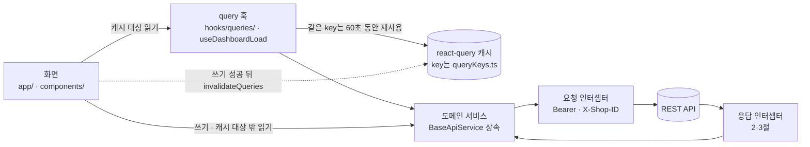
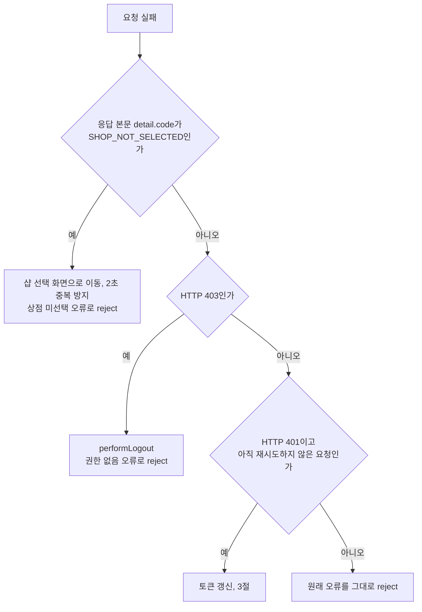
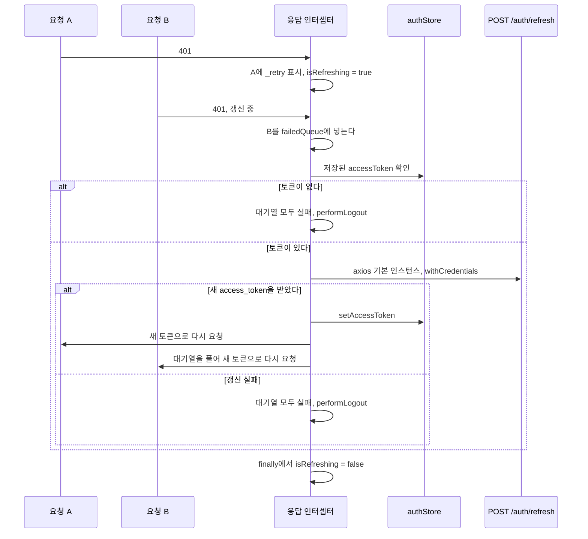
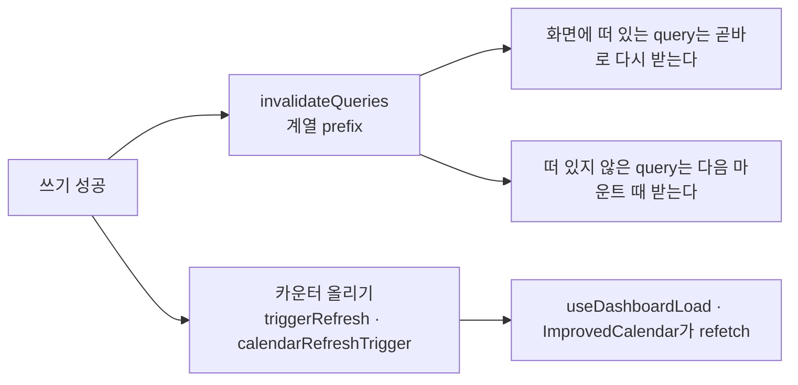
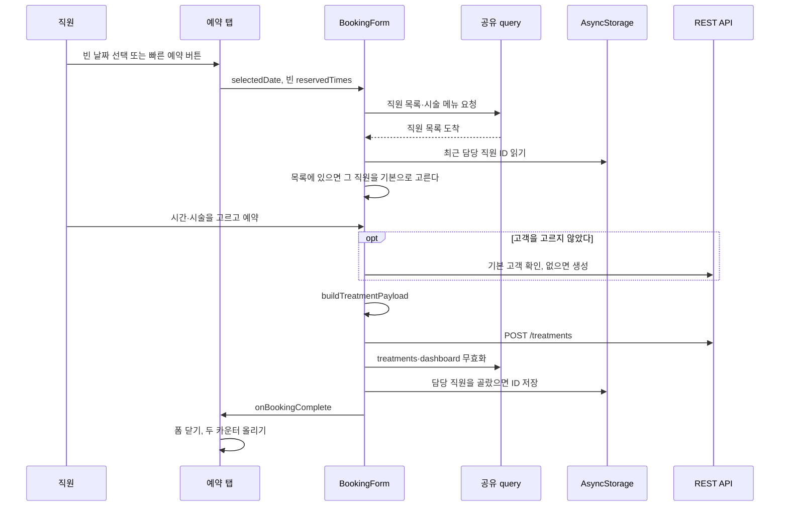
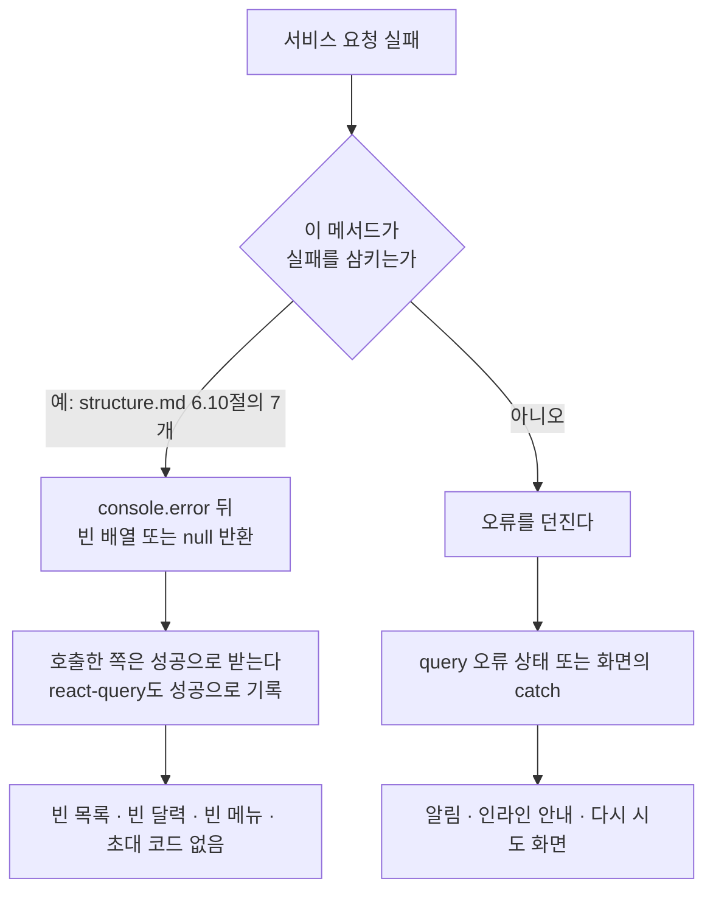

# KMC Beauty Native — 데이터 흐름 코드맵

> 기준: 2026-10-17 · 브랜치 `feature/refactor-hardening-2026-07` · HEAD `16ac428`
> 데이터가 화면과 서버 사이를 오가는 길, 캐시가 채워지고 다시 채워지는 때, 오류를 처리하는 순서를 정리했다. 규칙과 예외의 정본은 [structure.md](../structure.md) 5·6·8~10절이다.

---

## 1. 읽기와 쓰기의 기본 경로

- 캐시 대상 읽기 다섯 가지(홈 대시보드, 예약 목록·달력, 시술 메뉴, 직원 목록, 전화번호부 목록)는 query 훅을 거친다. 다만 예약 목록 보기는 아직 서비스를 직접 부른다(structure.md 6.9절).
- 쓰기와 캐시 대상 밖의 읽기는 화면이 서비스를 직접 부른다. 어느 파일이 무엇을 부르는지는 structure.md 4.2절에 있다.
- 요청 인터셉터는 `authStore`의 `accessToken`으로 `Authorization: Bearer` 헤더를, `shopStore`의 `selectedShop.id`로 `X-Shop-ID` 헤더를 붙인다. 샵 ID가 없으면 헤더 없이 보낸다. 스토어는 `src/api/storeLoaders.ts`가 처음 한 번 불러와 캐시한 것을 쓴다.
- 서비스는 응답 본문(`response.data`)을 돌려준다. 기간 조회처럼 페이지가 여러 개인 읽기는 첫 페이지를 받은 뒤 나머지를 `Promise.allSettled`로 동시에 받아 합친다(structure.md 8.3절).

---

## 2. 응답 오류 처리 순서와 샵 선택

- HTTP 상태가 401이어도 `SHOP_NOT_SELECTED`를 먼저 처리한다. 이 순서는 `__tests__/clientInterceptors.test.ts`가 검사한다.
- 인터셉터는 인증·권한·샵 오류를 한국어 메시지를 담은 `Error`로 바꿔 reject한다. 위쪽 계층은 그 문자열로 오류 종류를 가른다. `useDashboardLoad`는 "인증이 만료"·"권한이 없습니다"가 들어 있으면 알림을 띄우지 않는다. `shopStore.loadSelectedShop`은 "상점이 선택되지 않았습니다"가 들어 있으면 `selectedShop`을 비운다(structure.md 6.8절).
- 샵 선택 화면은 샵 목록 요청이 `SHOP_NOT_SELECTED`로 실패해도 알림을 띄우지 않는다. 이미 그 화면에 있기 때문이다.

샵을 고르는 흐름:

1. `app/shop-selection.tsx`가 `shopApiService.list({ page: 1, size: 50 })`로 샵 목록을 받는다.
2. 샵을 누르면 `shopStore.selectShop(id)`가 `POST /shops/selected`를 보낸다. 이어서 `loadSelectedShop()`이 `GET /shops/selected`로 선택한 샵을 받아 `shop-storage`에 저장한다.
3. 성공 햅틱 뒤 돌아갈 화면이 있으면 `router.back()`, 없으면 `/(tabs)`로 간다.
4. 이후 요청에는 새 `X-Shop-ID`가 붙는다. query key마다 `shopId`가 들어 있어서 샵을 바꾸면 다른 캐시 항목을 쓴다. 이전 샵의 항목을 지우는 코드는 없다. 쓰이지 않는 항목은 `gcTime`(5분)이 지나면 사라진다.

---

## 3. 401과 토큰 갱신

- 갱신 요청은 인터셉터를 다시 타지 않도록 axios 기본 인스턴스로 보낸다. 리프레시 토큰은 HttpOnly 쿠키라서 본문은 비어 있고 `withCredentials: true`로 쿠키를 싣는다.
- 새 토큰은 `authStore.setAccessToken`으로 들어가고 persist가 `secureHybridStorage`를 거쳐 SecureStore에 저장한다.
- 갱신에 실패하면 대기 중인 요청이 모두 같은 오류로 끝난다. `performLogout`은 두 스토어를 초기화하고 AsyncStorage에서 `remembered-email`과 `system-`으로 시작하는 키를 뺀 나머지를 지운 뒤 `/login`으로 보낸다. 원래 요청은 "인증이 만료되었습니다. 다시 로그인해주세요." 오류로 끝난다.
- 다시 보낸 요청이 또 401을 받으면 `_retry` 표시가 있으므로 갱신하지 않고 그대로 실패한다.
- 저장된 토큰이 없을 때 받은 401도 이 경로로 들어온다. 이때는 갱신 요청 없이 바로 강제 로그아웃으로 끝난다. 로그인 요청이 401로 실패하는 경우도 여기에 해당한다.
- 이 구간은 `@MX:WARN`이 붙은 계약이다(SPEC-REFACTOR-001 REQ-REF-002). 단일·동시 401, 갱신 실패, 기본 인스턴스 사용을 `__tests__/clientInterceptors.test.ts`가 검사한다.

---

## 4. 서버 상태를 받고 다시 받는 때

QueryClient 기본값은 `staleTime` 60초, `gcTime` 5분, `retry` 1회이고 캐시는 메모리에만 있다(structure.md 9.1절). 같은 key를 쓰는 화면이 60초 안에 다시 마운트되면 요청하지 않고 60초가 지났으면 마운트할 때 다시 받는다. `focusManager`·`onlineManager`나 `AppState`에 연결한 코드는 없다(정적 검색).

| 계열 | key를 쓰는 훅 | 처음 받는 때 | 명시적으로 다시 받는 때 |
|------|-------------|------------|---------------------|
| `dashboard` | `useDashboardLoad` | 홈이 마운트되고 `shopId`가 있을 때 | `dashboard` 무효화, `refreshTrigger` 증가, 당겨서 새로고침·머리글 새로고침·"다시 시도"(오늘 요약은 `force_refresh=true`로 받는다) |
| `treatments` 주간 | `useDashboardLoad` | 위와 같다 | `treatments` 무효화, `refreshTrigger` 증가, 위의 세 가지 새로고침 |
| `treatments` 월간 | `useMonthlyTreatmentsQuery` | 달력이 마운트되거나 월을 옮길 때 | `treatments` 무효화, 예약 탭의 `calendarRefreshTrigger` 증가 |
| `shopUsers` | `useShopUsersQuery`, `useStaffUsersQuery` | 예약 폼이나 직원 관리가 마운트될 때 | 직원 관리의 새로고침, 예약 폼 직원 목록 오류 안내의 다시 시도. 무효화하는 코드는 없다 |
| `treatmentMenus` | `useTreatmentMenusQuery` | 예약 폼이나 시술 메뉴 관리가 마운트될 때 | 메뉴·세부 항목 저장과 삭제 뒤 무효화 |
| `phonebook` | `usePhonebookQuery` | 전화번호 관리가 마운트되거나 검색어를 제출할 때 | 고객 추가·수정·삭제와 연락처 동기화 완료 뒤 무효화 |

key 형태와 훅별 소비 화면은 structure.md 9.2절에 있다.

---

## 5. 쓰기 뒤 화면 갱신

| 쓰는 곳 | 계기 | 무효화하는 계열 | 카운터 |
|--------|------|---------------|-------|
| `BookingForm` | 예약 생성 | `treatments`, `dashboard` | 완료 콜백을 받은 예약 탭이 `triggerRefresh()`와 `calendarRefreshTrigger`를 올린다 |
| `app/(tabs)/booking.tsx` | 예약 수정 완료(`EditTreatmentModal`의 완료 콜백) | `treatments`, `dashboard` | 예약 탭이 두 카운터를 올린다. `EditTreatmentModal`도 저장 뒤 `triggerRefresh()`를 부른다 |
| `PhonebookManagement` | 고객 추가·수정·삭제, 연락처 동기화 완료 | `phonebook` | — |
| `TreatmentMenuManagement` | 메뉴·세부 항목 저장과 삭제 | `treatmentMenus` | — |

갱신이 닿지 않는 곳:

- `shopUsers` 계열은 무효화하는 코드가 없다.
- `BookingForm`·`CustomerRegistrationModal`·`EditTreatmentModal`에서 새 고객을 만들어도 `phonebook` 계열은 무효화하지 않는다. 전화번호 관리를 60초 안에 다시 열면 이전 목록이 보일 수 있다.
- 예약 목록 보기(`BookingListScreen`)는 캐시를 쓰지 않으므로 무효화의 영향을 받지 않는다. 목록 보기에 머문 채 예약을 등록하면 당겨서 새로고침해야 새 예약이 보인다.

두 가지 새로고침 방식이 함께 남은 배경은 structure.md 6.3절에 있다.

---

## 6. 예약 등록의 기본값과 저장

폼을 여는 길은 달력에서 예약이 없는 날짜 누르기, "이 날짜에 예약하기", 빠른 예약 버튼 세 개(새 예약·오늘 예약·내일 예약), 목록 보기의 새 예약 버튼, 날짜별 예약 목록 모달의 새 예약이다. 예약이 있는 날짜를 누르면 폼 대신 그날 목록이 열린다.

| 항목 | 기본값 | 코드 |
|------|-------|------|
| 날짜 | 예약 탭이 넘긴 날짜. 없으면 오늘(UTC 기준, 7절) | `components/forms/BookingForm.tsx` 62행 |
| 담당 직원 | 직원 목록을 처음 받았을 때 한 번만, AsyncStorage `@booking/last_staff_user_id`의 직원이 목록에 있으면 고른다. 없으면 미지정 | `loadLastStaffUserId`, `resolveRestoredStaff` |
| 시간 | 고르지 않은 상태로 시작한다. 오늘 날짜면 현재 시각 이후의 첫 슬롯(09:00~18:30, 30분 간격)을 강조만 한다. 넘겨받은 `reservedTimes`가 늘 비어 있어 예약 여부는 보지 않는다 | `findFirstAvailableSlotAfter` |
| 결제 방법 | `CARD` | `components/forms/BookingForm.tsx` 76행 |
| 고객 | 고르지 않아도 된다. 저장할 때 전화번호 `999-9999-9999`인 "고객 미지정"을 `checkDuplicate`·`search`로 찾고 없으면 만든다 | `getOrCreateDefaultCustomer` |

- 요청 본문은 `src/utils/bookingPayload.ts`의 `buildTreatmentPayload`가 만든다. `reserved_at`은 `${날짜}T${시간}:00`(시간대 없음), `status`는 `RESERVED`, `payment_method`는 늘 들어가고 `staff_user_id`는 담당 직원을 골랐을 때만 넣는다.
- 시술 항목에는 `menu_detail_id`, `session_no`, 메뉴의 기본 가격(`base_price`), 조정한 소요 시간(`duration_min`)이 들어간다. 폼에서 조정한 가격은 들어가지 않는다(product.md 로드맵 6번).
- 성공하면 안내창 없이 햅틱을 한 번 내고 폼을 닫는다. 실패하면 "예약 생성에 실패했습니다" 알림을 띄우고 폼을 그대로 둔다.
- 예약 수정(`EditTreatmentModal`)은 `treatmentApiService.update`(`PUT /treatments/{id}`)로 저장한다. 등록과 달리 `reserved_at`을 `toISOString()`(UTC) 형식으로 보내고 시술 가격은 조정한 값을 보낸다.

---

## 7. 날짜를 정하는 곳

기기 시간대가 한국 표준시(UTC+9)일 때의 동작이다. 2026-10-17에 jest 임시 테스트를 `TZ=Asia/Seoul`로 돌려 요청 파라미터와 달력 칸을 확인했다. 기기(Hermes)에서는 확인하지 않았다. 고칠 계획은 product.md 로드맵 6번이다.

| 쓰임 | 위치 | 계산 | 결과 |
|------|------|------|------|
| 홈의 오늘 목록 | `app/(tabs)/index.tsx` 53행 | `new Date().toISOString()`의 날짜 부분 | 오전 9시 전에는 전날 |
| 오늘 요약 조회일 | `src/api/services/dashboard.ts` 37행 | 같다 | 오전 9시 전에는 전날 |
| 주간 범위 | `src/api/services/treatment.ts` 101~114행 | 이번 주 월요일과 일요일을 현지 시각으로 구한 뒤 `toISOString()` | 일요일에는 다음 주. 오전 9시 전에는 하루씩 앞당긴 일~토 |
| 월간 범위 | `src/api/services/treatment.ts` 41~42행 | 시작은 `YYYY-MM-01`, 끝은 말일 0시(현지)의 `toISOString()` | 끝 날짜가 말일 전날 |
| 달력 칸 | `src/utils/calendarUtils.ts` 40~79행 | 날짜마다 0시(현지)의 `toISOString()` | 칸 날짜가 하루씩 앞당겨진다 |
| 예약 폼 기본 날짜 | `components/forms/BookingForm.tsx` 62행, `app/(tabs)/booking.tsx` 92·267·281·392행 | `toISOString()`의 날짜 부분 | 오전 9시 전에는 전날("내일 예약"은 오늘) |
| 예약 시각(등록) | `src/utils/bookingPayload.ts` 65행 | `${날짜}T${시간}:00` | 시간대 없는 현지 시각 |
| 예약 시각(수정) | `components/modals/EditTreatmentModal.tsx` 391행 | `toISOString()` | UTC(`Z`). 서버 처리는 확인하지 못했다 |
| 홈 캐시 key | `hooks/useDashboardLoad.ts` 36·47행 | `toISOString()`의 날짜 부분 | 캐시를 구분하는 데만 쓰인다 |

일요일 주간 범위 문제는 시간대와 관계없이 생긴다(`TZ=UTC`에서도 같은 결과).

---

## 8. 연락처 동기화

1. `ContactSyncModal`이 열리면 권한 상태(`checkContactsPermission`)와 마지막 동기화 시각(AsyncStorage `contact_sync_last_time`)을 읽고 서버 그룹(`getGroups`)과 기기 그룹을 합쳐 그룹 목록을 만든다.
2. 권한이 있으면 미리보기를 만든다. 첫 동기화면 기기 연락처 전부를 신규로 보여 주고 그 뒤에는 서버 연락처(`getAllContacts` 또는 `getContactsByGroup`)와 전화번호로 비교해 신규와 수정 대상을 센다.
3. 동기화를 누르면 `contactSyncService.performFullSync`가 권한을 요청하고(`requestContactsPermission`), 기기 연락처를 읽은 뒤(`getDeviceContacts`, `expo-contacts` 동적 import) `syncContactsWithServer`를 부른다.
4. `syncContactsWithServer`는 서버 연락처 전체를 받아 전화번호로 맵을 만들고 서버에 없는 번호만 그룹 "연락처 동기화"로 하나씩 등록한다(요청 사이 100ms). 이미 있는 번호는 이름이 달라도 건너뛴다. 다 돌면 마지막 동기화 시각을 저장한다.
5. 결과는 `onSyncComplete`로 돌아간다. 전화번호 관리는 `phonebook` 계열을 무효화한다. 예약 등록 폼은 최근 고객 목록을 다시 받고 예약 수정 모달은 동기화 모달만 닫는다.

- 미리보기와 실제 동작이 다르다. 미리보기는 이름이나 그룹이 다른 기존 연락처를 "수정" 대상으로 보여 주지만 동기화는 기존 연락처를 고치지 않는다(`src/services/contactSync.ts` 510~513행).
- 서버 연락처 조회가 실패를 삼키면(9절) 동기화는 서버에 연락처가 없다고 보고 모든 기기 연락처의 등록을 시도한다. 영향과 확인하지 못한 부분은 structure.md 6.10절과 product.md 로드맵 4번에 있다.

---

## 9. 조용한 실패

- 실패를 삼키는 메서드는 `getWeeklyTreatments`, `getMonthlyTreatments`, `getAllWithDetails`, `getAllContacts`, `getContactsByGroup`, `getCurrentInviteCode`, 그리고 첫 요청 실패만 삼키는 `getCurrentShopUsers`다(structure.md 6.10절).
- 그래서 홈의 `weeklyError` 안내와 예약 폼·시술 메뉴 관리의 메뉴 로드 실패 알림은 지금 실행 경로에서 나타나지 않는다.
- 오류가 그대로 올라오는 경로의 예: 직원 목록(`getUsers`)은 예약 폼의 인라인 안내와 다시 시도 버튼으로, 오늘 요약은 알림과 "다시 시도" 화면으로 보인다.

---

## 10. 앱 시작, 로그인, 로그아웃

1. **앱 시작**: `StoreInitializer`가 `loadUser()`를 부른다. 스토어에 액세스 토큰이 없으면 요청하지 않는다. 있으면 `GET /users/me`로 사용자 정보를 받아 `isAuthenticated`를 켠다. 인증됐으면 이어서 `loadSelectedShop()`이 `GET /shops/selected`를 보낸다. 진입 게이트의 분기는 [entry-points.md](entry-points.md) 1절에 있다.
2. **로그인**: `LoginForm`이 `onLogin`으로 이메일과 비밀번호를 넘긴다. `app/login.tsx`의 `handleLogin`이 `authStore.login()`을 부른다. 이 액션은 `POST /auth/login` → `setAccessToken` → `GET /users/me` → `setUser` 순서로 진행한다. 이어서 `loadSelectedShop()`을 부른다. 어느 단계든 실패하면 "로그인 실패" 알림을 띄운다. `isAuthenticated`가 켜지면 로그인 화면이 `/(tabs)`로 보낸다.
3. **초대 가입**: `InviteSignupForm`이 `onSignup`으로 입력을 넘기면 `app/login.tsx`가 `inviteApiService.signupWithInviteCode`(`POST /users`)를 부른다. 성공하면 안내 뒤 로그인 모드로 돌아간다.
4. **로그아웃**: 사용자 로그아웃(프로필)과 강제 로그아웃(`src/api/client.ts`)이 지우는 것과 남기는 것은 structure.md 10.4절에 있다. 두 경로 모두 react-query 캐시를 비우지 않는다(product.md 로드맵 16번).

기기에 남는 저장 키 전체는 structure.md 10.3절에 있다.
