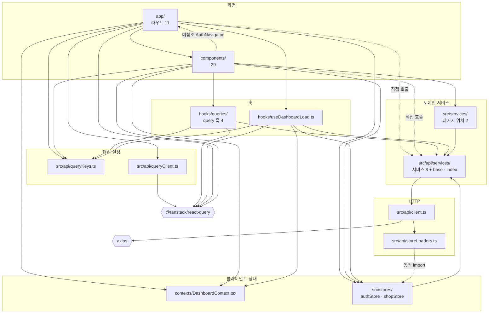

# KMC Beauty Native — 의존성 코드맵

> 기준: 2026-10-17 · 브랜치 `feature/refactor-hardening-2026-07` · HEAD `16ac428`
> 모듈 사이의 import 관계와 외부 패키지를 쓰는 위치를 정리했다. `app/`·`components/`·`hooks/`·`contexts/`·`src/`의 `.ts`·`.tsx` 파일 96개에서 정적 import, 동적 `import()`, type-only import를 TypeScript 구문 트리로 모아 간선을 만들었다. 지켜야 할 의존 방향과 그 이유는 [structure.md](../structure.md) 3~5절이 정본이다.

---

## 1. 모듈 의존 그래프



- 실선은 값(value) import다. 점선은 동적 import이거나 structure.md 3절이 예외로 허용한 경로, 또는 쓰이지 않는 파일에서 나온 간선이다.
- 공용 모듈(`src/types/`, `src/ui/`, `src/utils/`)과 테마 훅(`hooks/useColorScheme.ts`, `hooks/useThemeColor.ts`)으로 가는 간선은 그림에서 뺐다. 거의 모든 모듈이 이들을 쓰기 때문이다. 공용 모듈이 위쪽 계층을 참조하는 예외는 3절에 있다.
- 화면이 서비스를 직접 부르는 곳이 쓰기인지 읽기인지는 structure.md 4.2절 표에 있다.

---

## 2. 간선별 파일

| 출발 → 도착 | 파일 수 | 파일·내용 |
|------------|-------:|----------|
| `app/` → `components/` | 9 | `app/_layout.tsx`와 `app/index.tsx`를 뺀 모든 라우트 파일. `app/(tabs)/booking.tsx`와 `app/(tabs)/management.tsx`가 각각 6개로 가장 많다 |
| `app/` → `hooks/useDashboardLoad.ts` | 1 | `app/(tabs)/index.tsx` |
| `app/` → `contexts/` | 2 | `app/(tabs)/_layout.tsx`(Provider), `app/(tabs)/booking.tsx`(`triggerRefresh`) |
| `app/` → `src/stores/` | 6 | `app/_layout.tsx`, `app/index.tsx`, `app/login.tsx`, `app/shop-selection.tsx`, `app/(tabs)/_layout.tsx`, `app/(tabs)/profile.tsx` |
| `app/` → `src/api/services/` | 3 | `app/login.tsx`(초대 가입), `app/shop-selection.tsx`(샵 목록), `app/(tabs)/profile.tsx`(비밀번호 변경) |
| `app/` → `src/api/queryClient.ts` | 1 | `app/_layout.tsx` |
| `app/` → `src/api/queryKeys.ts` | 1 | `app/(tabs)/booking.tsx`(예약 수정 뒤 무효화) |
| `components/` → `hooks/queries/` | 5 | `ImprovedCalendar`, `BookingForm`, `StaffManagement`, `PhonebookManagement`, `TreatmentMenuManagement` |
| `components/` → `contexts/` | 1 | `EditTreatmentModal` |
| `components/` → `src/stores/` | 8 | `AuthNavigator`만 `authStore`, 나머지 7개는 `shopStore` |
| `components/` → `src/api/services/` | 11 | 값·동적 import 기준. 타입만 가져오는 `SelectedTreatmentItem`은 뺐다 |
| `components/` → `src/api/queryKeys.ts` | 3 | `BookingForm`, `PhonebookManagement`, `TreatmentMenuManagement` |
| `components/` → `src/services/` | 2 | `ContactSyncModal`(값·동적 import), `BookingForm`(타입만) |
| `components/` → `app/` | 1 | 미참조 `AuthNavigator`가 `app/login.tsx`를 import한다 |
| `hooks/queries/` → `src/api/services/`·`src/api/queryKeys.ts` | 4 | 훅 파일 4개 모두 |
| `hooks/useDashboardLoad.ts` → 서비스·`src/api/queryKeys.ts`·`src/stores/`·`contexts/` | 1 | 서비스는 `dashboard`·`treatment`, 스토어는 `shopStore` |
| `src/stores/` → `src/api/services/` | 2 | `authStore` → `src/api/services/auth.ts`, `shopStore` → `src/api/services/shop.ts` |
| `src/services/` → `src/api/services/` | 2 | `src/services/contactSync.ts` → `src/api/services/phonebook.ts`, 미참조 `src/services/storage/userDataService.ts` → `src/api/services/auth.ts`·`src/api/services/shop.ts` |
| `src/api/services/` → `src/api/client.ts` | 1 | `src/api/services/base.ts` |
| `src/api/client.ts` → `src/api/storeLoaders.ts` | 1 | 토큰·샵 ID 읽기, 강제 로그아웃 때 스토어 초기화 |
| `src/api/storeLoaders.ts` → `src/stores/` | 1 | 동적 import. 타입은 `import type`으로만 참조한다 |

---

## 3. 위쪽을 향하는 의존과 순환 차단

- 정적 import만 따라가면 `src/api/services/base.ts` → `src/api/client.ts` → 스토어 → 서비스 → 다시 `src/api/services/base.ts`로 고리가 생긴다. HTTP 클라이언트는 스토어를 정적으로 import하지 않고 `src/api/storeLoaders.ts`의 지연 import를 써서 이 고리를 끊는다(structure.md 4.3절).
- 아래 계층이 위 계층을 참조하는 곳은 10곳이고 structure.md 4.4절 표에 모두 있다. 공용 모듈에서 나오는 것은 `src/types/shop.ts`·`src/types/user.ts` → `src/api/services/staff.ts`(타입), `src/utils/bookingPayload.ts` → `src/api/services/shop.ts`·`components/forms/SelectedTreatmentItem.tsx`(타입)와 AsyncStorage, `src/utils/authDebug.ts` → `src/api/services/auth.ts`(개발용 동적 import)다.
- `src/stores/shopStore.ts`는 개발 모드에서만 `authStore`를 동적 import해 토큰 상태를 로그로 남긴다.

---

## 4. 외부 패키지를 쓰는 곳

버전과 선언 범위는 [tech.md](../tech.md) 1절에 있다.

| 패키지 | import하는 파일 |
|--------|----------------|
| `axios` | `src/api/client.ts` 1개 |
| `@tanstack/react-query` | 11개. `src/api/queryClient.ts`, `hooks/queries/`의 4개, `hooks/useDashboardLoad.ts`, `app/_layout.tsx`(`QueryClientProvider`), 무효화를 위해 `useQueryClient`를 쓰는 `app/(tabs)/booking.tsx`·`BookingForm`·`PhonebookManagement`·`TreatmentMenuManagement` |
| `zustand` | `create`·`persist`는 `src/stores/authStore.ts`·`src/stores/shopStore.ts`. `useShallow`(`zustand/react/shallow`)는 `app/index.tsx`, `app/login.tsx`, `app/(tabs)/_layout.tsx`, `app/(tabs)/profile.tsx`, `ShopHeader`, `AuthNavigator` 6개 |
| `expo-secure-store` | `src/stores/authStore.ts` 1개 |
| `@react-native-async-storage/async-storage` | 8개. `src/stores/authStore.ts`, `src/stores/shopStore.ts`, `src/api/client.ts`, `components/forms/LoginForm.tsx`, `src/utils/bookingPayload.ts`, `src/utils/authDebug.ts`, `src/services/contactSync.ts`, 미참조 `src/services/storage/userDataService.ts` |
| `expo-router` | 12개. `app/` 파일 9개(`app/(tabs)/booking.tsx`와 `app/(tabs)/management.tsx` 제외), `ShopHeader`, `AuthNavigator`, `src/api/client.ts` |
| `expo-contacts` | `src/services/contactSync.ts`(동적 import 2곳) |
| `expo-haptics` | `components/HapticTab.tsx`, `components/forms/BookingForm.tsx`, `app/shop-selection.tsx` |

---

## 5. 환경 변수

| 이름 | 읽는 곳 | 내용 |
|------|--------|------|
| `EXPO_PUBLIC_API_BASE_URL` | `src/api/client.ts`, `jest.setup.js` | 백엔드 API 기본 주소. HTTP 클라이언트는 값이 없으면 모듈을 불러올 때 예외를 던진다. `jest.setup.js`는 값이 비어 있으면 테스트용 값을 채운다. 값은 저장소에 기록하지 않는다 |
| `EXPO_OS` | `components/HapticTab.tsx` | Expo가 채우는 플랫폼 값. iOS일 때만 햅틱을 낸다 |

설정 방법은 tech.md 3.2절에 있다.

---

## 6. 다시 확인하는 명령

```bash
grep -rlE "from ['\"]@tanstack/react-query['\"]" app components hooks contexts src | wc -l           # 11
grep -rlE "from ['\"]axios['\"]" app components hooks contexts src                                  # src/api/client.ts
grep -rlE "['\"]@react-native-async-storage/async-storage['\"]" app components hooks contexts src | wc -l  # 8
grep -rlE "from ['\"]expo-router['\"]" app components hooks contexts src | wc -l                     # 12
grep -rlE "from ['\"]zustand/react/shallow['\"]" app components hooks contexts src | wc -l           # 6
# 화면이 서비스를 가져오는 줄(정적·동적 import, type-only 포함)
grep -rnE "(from|import\()\s*['\"][^'\"]*api/services/[^'\"]*['\"]" app components
```
