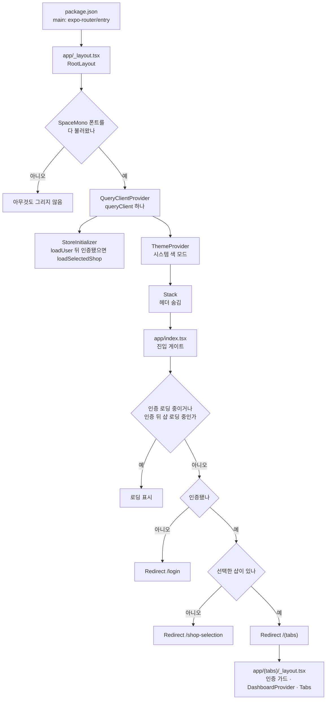

# KMC Beauty Native — 진입점 코드맵

> 기준: 2026-10-17 · 브랜치 `feature/refactor-hardening-2026-07` · HEAD `16ac428`
> 앱이 시작되는 순서, 라우트 파일과 레이아웃, Provider, 화면 밖에서 화면을 바꾸는 코드, 명령 진입점을 정리했다. 라우트별 접근 조건은 [structure.md](../structure.md) 7절이 정본이다.

---

## 1. 부팅 순서

`package.json`의 `main`은 `expo-router/entry`다. expo-router가 `app/_layout.tsx`를 루트로 그리고 `/` 경로의 `app/index.tsx`에서 갈 곳을 정한다.

- `StoreInitializer`는 처음 마운트될 때 한 번만 실행되고(`didInit` ref) 아무것도 그리지 않는다.
- 진입 게이트는 인증된 상태가 되면 100ms 뒤 `loadSelectedShop()`을 한 번 더 부른다. 시작할 때 `GET /shops/selected`가 겹칠 수 있는 이유는 structure.md 7.2절에 있다.
- 탭 레이아웃은 인증만 확인한다. 샵 선택 여부는 진입 게이트와 `SHOP_NOT_SELECTED` 처리(4절)가 맡는다.

---

## 2. 라우트 파일

| 경로 | 파일 | 종류 | 그리는 것 | 들어오는 길 |
|------|------|------|----------|------------|
| — | `app/_layout.tsx` | 루트 레이아웃 | Provider와 `Stack`(1절) | 앱 시작 |
| `/` | `app/index.tsx` | 진입 게이트 | 로딩 표시 또는 `<Redirect>` 셋 중 하나 | 앱 시작, 없는 경로 화면의 홈 링크 |
| `/login` | `app/login.tsx` | 화면 | `LoginForm`과 `InviteSignupForm`(모드 전환) | 진입 게이트와 탭 레이아웃의 `<Redirect>`, 프로필의 로그아웃, 강제 로그아웃(4절) |
| `/shop-selection` | `app/shop-selection.tsx` | 화면 | 샵 목록, `ShopRegistrationModal` | 진입 게이트의 `<Redirect>`, `ShopHeader`(확인 창 뒤 `router.push`), `SHOP_NOT_SELECTED` 처리(4절) |
| — | `app/(tabs)/_layout.tsx` | 탭 레이아웃 | 인증 가드, `DashboardProvider`, 탭 4개(홈·예약·관리·프로필), `HapticTab`·`TabBarBackground`·`IconSymbol` | `/(tabs)` 아래 모든 경로 |
| `/(tabs)` | `app/(tabs)/index.tsx` | 홈 탭 | `ShopHeader`, 오늘의 예약, `UnifiedTreatmentModal`, `MonthlyDashboard`(모달) | 진입 게이트, 이미 인증된 상태의 로그인 화면, 샵 선택 완료(돌아갈 화면이 없을 때) |
| `/booking` | `app/(tabs)/booking.tsx` | 예약 탭 | `ShopHeader`, `ImprovedCalendar`·`BookingListScreen`(보기 전환), `BookingForm`(전체 화면 모달), `UnifiedTreatmentModal`, `EditTreatmentModal` | 탭 바, 홈의 "새 예약"(`router.push('/booking')`) |
| `/management` | `app/(tabs)/management.tsx` | 관리 탭 | `ShopHeader`와 메뉴. 고르면 `StaffManagement`·`PhonebookManagement`·`TreatmentMenuManagement` 중 하나로 바뀐다 | 탭 바 |
| `/profile` | `app/(tabs)/profile.tsx` | 프로필 탭 | `ShopHeader`, 내 정보, 비밀번호 변경, 로그아웃 | 탭 바 |
| `/monthly-dashboard` | `app/monthly-dashboard.tsx` | 화면 | `MonthlyDashboard` | 앱 안에서 이 경로로 이동하는 코드가 없다 |
| 그 밖 | `app/+not-found.tsx` | 화면 | 없는 경로 안내와 `/` 링크 | 일치하는 라우트가 없을 때 |

샵 선택 화면은 선택에 성공하면 돌아갈 화면이 있을 때 `router.back()`, 없을 때 `router.replace('/(tabs)')`를 부른다.

---

## 3. Provider와 초기화 컴포넌트

| 이름 | 위치 | 감싸는 범위 | 제공하는 것 |
|------|------|-----------|------------|
| `QueryClientProvider` | `app/_layout.tsx` | 앱 전체(가장 바깥) | `src/api/queryClient.ts`의 `queryClient`. 다른 파일은 `useQueryClient()`로 받는다 |
| `StoreInitializer` | `app/_layout.tsx` | — | 첫 마운트 때 `loadUser()`, 인증됐으면 이어서 `loadSelectedShop()` |
| `ThemeProvider` | `app/_layout.tsx` | `Stack` 전체 | 시스템 색 모드에 맞춘 `DarkTheme`/`DefaultTheme` |
| `DashboardProvider` | `app/(tabs)/_layout.tsx` | 탭 화면 4개 | `refreshTrigger`, `triggerRefresh()` |

`/login`, `/shop-selection`, `/monthly-dashboard`는 `DashboardProvider` 밖에 있다. 이 화면들이 쓰는 컴포넌트는 `useDashboard()`를 부르지 않는다.

---

## 4. 화면 밖에서 화면을 바꾸는 코드

화면 코드가 아니라 HTTP 클라이언트가 이동을 일으키는 경우다. 어느 화면에서 요청했든 같은 방식으로 처리한다.

| 계기 | 위치 | 이동 | 중복 이동 방지 |
|------|------|------|--------------|
| 응답 본문 `detail.code`가 `SHOP_NOT_SELECTED` | `src/api/client.ts` 응답 인터셉터 | `router.replace('/shop-selection')`, 실패하면 `router.push` | 2초 |
| HTTP 403, 토큰 갱신 실패, 저장된 토큰 없이 받은 401 | `src/api/client.ts`의 `performLogout` | 스토어와 기기 저장소를 정리한 뒤 `router.replace('/login')`, 실패하면 `router.push` | 3초 |

처리 순서와 대기열 동작은 [data-flow.md](data-flow.md) 2·3절에 있다.

---

## 5. 개발 모드 전용 진입점

- `app/index.tsx`는 `__DEV__`일 때 `src/utils/authDebug.ts`를 동적 import한다. 이 파일은 `checkAuthState`·`forceReset`·`testAuthenticatedRequest`를 담은 디버그 객체를 `global.authDebug`에 등록한다.
- `src/api/client.ts`도 `__DEV__`일 때 `authDebugUtils`(401·403 흉내, 토큰 상태 확인, 갱신·로그아웃 시험 등)를 같은 이름 `global.authDebug`로 등록한다. 두 파일이 같은 전역 이름을 쓰므로 나중에 불러온 쪽이 앞의 것을 덮어쓴다.

---

## 6. 명령 진입점

npm 스크립트의 정본은 tech.md 3.3절이다.

| 명령 | 하는 일 |
|------|--------|
| `npm start` | `expo start` |
| `npm run android`, `npm run ios` | `expo run:android`, `expo run:ios` |
| `npm run web` | `expo start --web` |
| `npm run emulator` | `scripts/run-android-emulator.sh` 실행. WSL2에서 Windows의 Android 에뮬레이터를 띄운다(tech.md 3.5절) |
| `npm run lint` | `expo lint` |
| `npm test` | `jest`. 설정은 `jest.config.js`, 준비 코드는 `jest.setup.js` |
| `npm run reset-project` | `scripts/reset-project.js` 실행. Expo 템플릿 초기화 스크립트라 디렉터리를 옮긴다. 이 저장소에서는 실행하지 않는다 |

앱 빌드는 EAS 빌드 프로필(`eas.json`)로 한다. 프로필 구성은 tech.md 4.1절에 있다.
