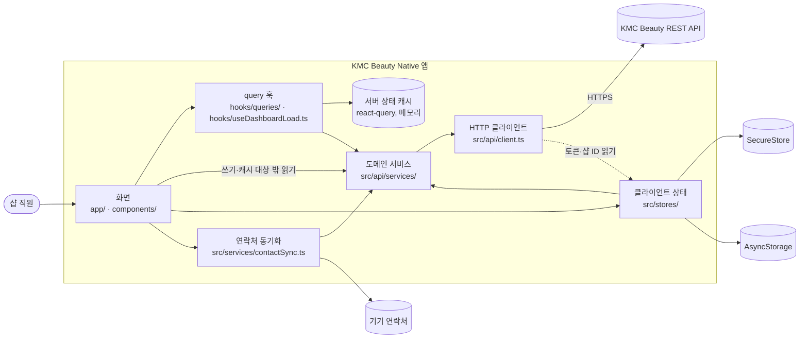

# KMC Beauty Native — 개요 코드맵

> 기준: 2026-10-17 · 브랜치 `feature/refactor-hardening-2026-07` · HEAD `16ac428`
> 코드맵은 코드를 찾아가는 지도다. 계층 규칙과 경계 예외는 [structure.md](../structure.md), 버전·설정·검증 결과는 [tech.md](../tech.md), 기능과 로드맵은 [product.md](../product.md)가 정본이다. 내용이 겹치면 정본을 따른다.

---

## 1. 코드맵 다섯 개

| 문서 | 답하는 질문 |
|------|------------|
| overview.md(이 문서) | 앱이 어떤 부분으로 이루어지고 바깥 시스템과 어디서 만나는가 |
| [modules.md](modules.md) | 폴더와 파일이 각각 무엇을 맡고 무엇을 내보내는가 |
| [dependencies.md](dependencies.md) | 어느 모듈이 어느 모듈을 import하는가, 외부 패키지는 어디서 쓰는가 |
| [entry-points.md](entry-points.md) | 앱은 어디서 시작하고 각 화면에는 어떻게 들어오는가 |
| [data-flow.md](data-flow.md) | 데이터가 화면과 서버 사이를 어떤 길로 오가고 캐시는 언제 다시 채워지는가 |

---

## 2. 시스템 한눈에 보기

미용실 직원이 예약·고객·시술 메뉴·직원을 관리하는 Expo(React Native) 앱이다. 서버 데이터는 모두 KMC Beauty 백엔드 REST API에서 오고 기기에는 로그인 상태와 몇 가지 설정만 남는다. 계층별 의존 규칙의 정본은 [structure.md](../structure.md) 3절의 계층 모델이다. 아래 그림은 바깥 시스템과 만나는 지점을 중심으로 그렸다.

---

## 3. 바깥 시스템과 만나는 곳

| 바깥 시스템 | 만나는 파일 | 내용 | 자세히 |
|------------|------------|------|--------|
| KMC Beauty REST API | `src/api/client.ts` | axios 인스턴스 하나로 모든 요청을 보낸다. 기본 주소는 환경 변수 `EXPO_PUBLIC_API_BASE_URL`, 타임아웃은 15초다 | structure.md 8.1절, [data-flow.md](data-flow.md) 1~3절 |
| 리프레시 토큰 쿠키 | `src/api/client.ts` | 401을 받으면 `POST /auth/refresh`(`withCredentials`)로 액세스 토큰을 새로 받는다. 리프레시 토큰은 서버가 HttpOnly 쿠키로 관리한다 | [data-flow.md](data-flow.md) 3절 |
| SecureStore | `src/stores/authStore.ts` | 액세스 토큰(키 `auth_access_token`)만 저장한다 | structure.md 10.1절 |
| AsyncStorage | 8개 파일 | 로그인·샵 상태(persist), 아이디 기억, 최근 담당 직원, 마지막 연락처 동기화 시각 | structure.md 10.3절, [dependencies.md](dependencies.md) 4절 |
| 기기 연락처 | `src/services/contactSync.ts` | `expo-contacts`를 동적 import하고 연락처 권한을 요청한다 | [data-flow.md](data-flow.md) 8절 |
| 빌드·배포 | `eas.json`, `app.json` | EAS 빌드 프로필 3개(development·preview·production) | tech.md 4절 |

---

## 4. 규모

2026-10-17에 다시 셌다.

- 소스 파일 96개: `app/` 11 · `components/` 29 · `hooks/` 8 · `contexts/` 1 · `src/` 47. 모두 합쳐 20,489행이다(`wc -l`).
- 테스트 파일 24개(`__tests__/`). 실행 결과와 커버리지는 tech.md 5절에 있다.
- 500행이 넘는 파일은 13개다. 줄 수 상위 10개는 다음과 같다.

| 파일 | 행 수 | 맡은 일 |
|------|------:|--------|
| `components/modals/EditTreatmentModal.tsx` | 1,665 | 예약 수정 |
| `components/forms/BookingForm.tsx` | 1,111 | 예약 등록 |
| `components/modals/ContactSyncModal.tsx` | 917 | 연락처 동기화 화면 |
| `src/services/contactSync.ts` | 782 | 연락처 동기화 로직(레거시 위치) |
| `components/management/TreatmentMenuManagement.tsx` | 779 | 시술 메뉴 관리 |
| `components/dashboard/MonthlyDashboard.tsx` | 739 | 월간 현황 |
| `components/forms/BookingForm.styles.ts` | 738 | 예약 등록 스타일 |
| `components/modals/UnifiedTreatmentModal.tsx` | 692 | 예약 상세·날짜별 목록 |
| `app/(tabs)/booking.tsx` | 614 | 예약 탭 |
| `components/booking/BookingListScreen.tsx` | 588 | 예약 목록 보기 |

---

## 5. 설계 결정이 남아 있는 자리

| 결정 | 코드 위치 | 정본 |
|------|----------|------|
| HTTP 요청은 axios 인스턴스 하나로만 보낸다 | `src/api/client.ts`, 이를 import하는 유일한 파일 `src/api/services/base.ts` | structure.md 5.1절 1·2번 |
| 도메인 서비스 8개는 `BaseApiService`를 상속한 싱글턴이다 | `src/api/services/` | structure.md 8.2·8.3절 |
| 캐시 대상 읽기 다섯 가지만 react-query로 읽는다. 쓰기는 서비스를 직접 부른 뒤 계열(prefix) 단위로 무효화한다 | `src/api/queryKeys.ts`, `src/api/queryClient.ts`, `hooks/queries/` | structure.md 5.2·9절 |
| HTTP 클라이언트는 스토어를 지연 import해 순환 참조를 끊는다 | `src/api/storeLoaders.ts` | structure.md 4.3절 |
| 액세스 토큰은 SecureStore, 나머지 로그인 상태는 AsyncStorage에 나눠 저장한다 | `src/stores/authStore.ts`의 `secureHybridStorage` | structure.md 10.1절 |
| 동시에 들어온 401은 토큰 갱신 한 번으로 처리한다 | `src/api/client.ts` 응답 인터셉터 | [data-flow.md](data-flow.md) 3절 |
| 기간 조회는 첫 페이지를 받은 뒤 나머지 페이지를 동시에 받는다(최대 20페이지) | `src/api/services/treatment.ts` | structure.md 8.3절 |
| 예약 요청 본문은 순수 함수 하나에서 만든다 | `src/utils/bookingPayload.ts`의 `buildTreatmentPayload` | [data-flow.md](data-flow.md) 6절 |

---

## 6. 먼저 알아 둘 예외와 위험

- 규칙을 벗어난 현재 코드 열 가지(서비스를 직접 다루는 폼, 공유 query를 쓰지 않는 수정 모달, 두 가지 새로고침 방식, 오류를 삼키는 서비스 읽기 등)는 structure.md 6절에 있다.
- 날짜를 UTC 기준으로 계산하는 문제, 일요일 주간 범위 문제, 등록할 때 조정한 시술 가격이 빠지는 문제는 [data-flow.md](data-flow.md) 6·7절과 product.md 로드맵 6번에 있다.
- 타입 검사·린트 기준선 오류와 테스트 결과는 tech.md 5.2절에 있다.
