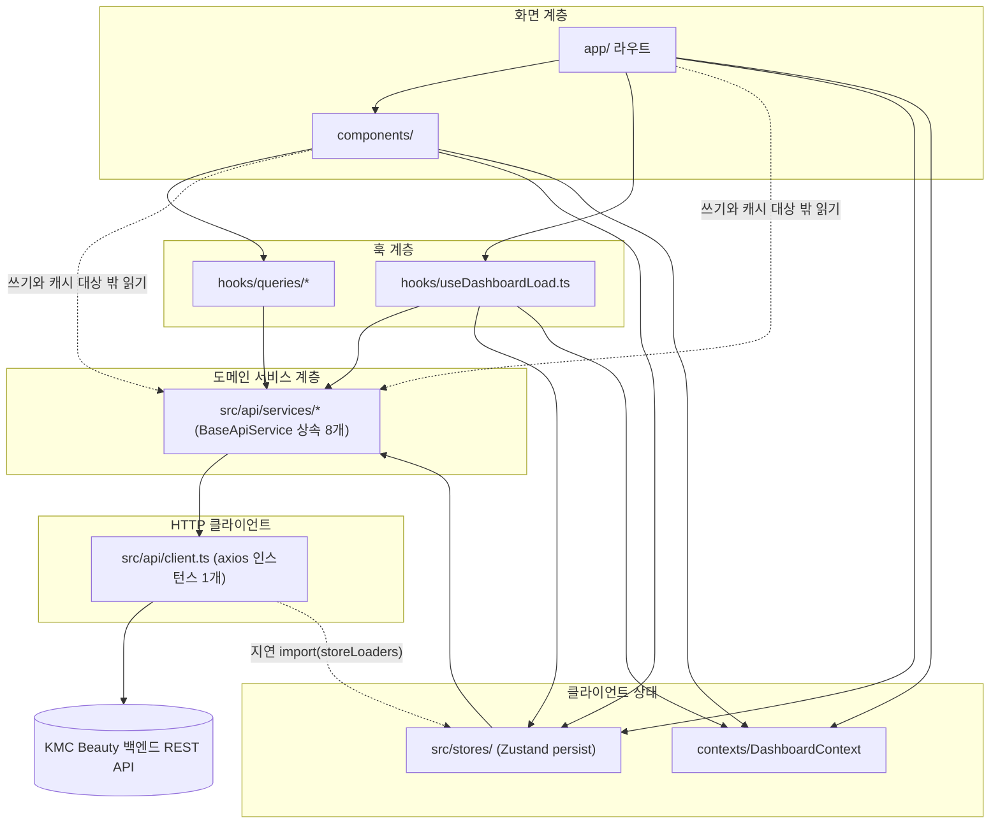

# KMC Beauty Native — 구조 문서

> 기준: 2026-10-16 · 브랜치 `feature/refactor-hardening-2026-07` · HEAD `16ac428`
> 경로·파일 수·의존 관계는 모두 위 시점에 직접 검색해 확인했다. 다시 확인하는 명령은 14절에 모았다.
> 범위: `app/`, `components/`, `hooks/`, `contexts/`, `src/`, `__tests__/`, `scripts/`, 빌드 설정. MoAI 도구(`.claude/`, `.moai/`), `node_modules/`, 백엔드 내부 구현은 다루지 않는다.
> 이 문서가 인용하는 SPEC 가운데 SPEC-SECURITY-001은 `.moai/specs/`에 문서가 없다. 내용은 REFACTORING_GUIDE.md·코드 주석·커밋 메시지에 남아 있다(`product.md` 8절).

이 문서에서 가장 중요한 부분은 3~6절이다. 화면 → 훅 → 도메인 서비스 → HTTP 클라이언트로 이어지는 계층, 실제로 측정한 의존 방향, 지금 지켜지는 경계 규칙을 적었다. 규칙을 벗어난 현재 예외도 숨기지 않고 기록했다.

---

## 1. 최상위 디렉터리

| 경로 | 역할 | 이 문서에서 |
|------|------|------------|
| `app/` | expo-router 파일 기반 라우트(화면 진입점) | 다룸 |
| `components/` | 기능별 UI 컴포넌트 | 다룸 |
| `hooks/` | 서버 상태 query 훅, 테마 훅 | 다룸 |
| `contexts/` | React Context(대시보드 새로고침 신호) | 다룸 |
| `src/` | API 계층, 스토어, 타입, 디자인 시스템, 유틸리티 | 다룸 |
| `__tests__/` | Jest 테스트 | 다룸 |
| `scripts/` | 개발 보조 스크립트 | 다룸 |
| `assets/` | 앱 아이콘·스플래시 이미지, 폰트 `SpaceMono-Regular.ttf` | 참고만 |
| `docs/` | 개발 환경 문서(`running-on-emulator.md`) | 참고만 |
| `.github/` | 라벨 동기화 워크플로와 프롬프트(MoAI 도구 위주) | 다루지 않음 |
| `.claude/`, `.moai/`, `.moai-backups/`, `.git_hooks/` | MoAI 도구 | 다루지 않음 |
| `.vscode/` | 편집기 설정 | 다루지 않음 |
| `coverage/`, `.expo/`, `node_modules/` | 생성물(git 무시) | 다루지 않음 |

루트 설정 파일: `package.json`, `package-lock.json`, `app.json`, `eas.json`, `tsconfig.json`, `babel.config.js`, `jest.config.js`, `jest.setup.js`, `eslint.config.js`, `metro.config.js`. `expo-env.d.ts`와 `.env`는 git이 무시한다. 설정 내용은 `tech.md`에 있다.

---

## 2. 디렉터리 트리

소스 파일(`.ts`/`.tsx`) 수: `app/` 11 · `components/` 29(하위 폴더 8) · `hooks/` 8 · `contexts/` 1 · `src/` 47, 합계 96개. 테스트 파일은 24개다.

```text
kmcbeauty-native/
├── app/                                  # 라우트 파일 11개(레이아웃 2 + 화면 9)
│   ├── _layout.tsx                       # 루트: QueryClientProvider 안에 StoreInitializer와 ThemeProvider(→ Stack)
│   ├── index.tsx                         # 진입 게이트: /login · /shop-selection · /(tabs) 로 Redirect
│   ├── login.tsx                         # 로그인 + 초대 가입 모드
│   ├── shop-selection.tsx                # 샵 목록·선택·등록
│   ├── monthly-dashboard.tsx             # 월간 현황(앱 안에서 이동하는 코드 없음)
│   ├── +not-found.tsx
│   └── (tabs)/
│       ├── _layout.tsx                   # 탭: 인증 가드 + DashboardProvider
│       ├── index.tsx                     # 홈(오늘의 예약)
│       ├── booking.tsx                   # 예약(달력/목록, 등록·상세·수정 모달)
│       ├── management.tsx                # 관리(직원·전화번호·시술 메뉴 하위 화면 전환)
│       └── profile.tsx                   # 프로필
├── components/                           # 29개 파일
│   ├── HapticTab.tsx                     # 탭 버튼 햅틱
│   ├── ThemedText.tsx
│   ├── ThemedView.tsx
│   ├── booking/
│   │   └── BookingListScreen.tsx         # 예약 목록 보기(20건 단위, 무한 스크롤)
│   ├── calendar/
│   │   └── ImprovedCalendar.tsx          # 월 달력(useMonthlyTreatmentsQuery)
│   ├── dashboard/
│   │   └── MonthlyDashboard.tsx          # 월간 현황
│   ├── forms/
│   │   ├── BookingForm.tsx               # 예약 등록(경계 예외, 6.1절)
│   │   ├── BookingForm.styles.ts
│   │   ├── InviteSignupForm.tsx
│   │   ├── LoginForm.tsx
│   │   └── SelectedTreatmentItem.tsx     # 선택한 시술 항목(가격·시간 조정)
│   ├── management/
│   │   ├── PhonebookManagement.tsx
│   │   ├── PhonebookManagement.styles.ts
│   │   ├── StaffManagement.tsx
│   │   └── TreatmentMenuManagement.tsx
│   ├── modals/                           # 모달 7개 + 스타일 1개
│   │   ├── ContactSyncModal.tsx
│   │   ├── CustomerRegistrationModal.tsx
│   │   ├── CustomerRegistrationModal.styles.ts
│   │   ├── EditTreatmentModal.tsx        # 1,665행, tsc 기준선 오류 2건
│   │   ├── InviteCodeGeneratorModal.tsx
│   │   ├── ShopRegistrationModal.tsx
│   │   ├── StaffRegistrationModal.tsx    # 정적 import 0건
│   │   └── UnifiedTreatmentModal.tsx     # 예약 상세 / 날짜별 목록
│   ├── navigation/
│   │   ├── AuthNavigator.tsx             # 정적 import 0건
│   │   └── ShopHeader.tsx                # 상단 샵 이름 → 샵 선택
│   └── ui/                               # 플랫폼별 파일 쌍
│       ├── IconSymbol.ios.tsx            # iOS: expo-symbols(SF Symbols)
│       ├── IconSymbol.tsx                # 그 밖: MaterialIcons
│       ├── TabBarBackground.ios.tsx      # iOS: expo-blur
│       └── TabBarBackground.tsx
├── hooks/                                # 8개 파일
│   ├── queries/                          # react-query 훅
│   │   ├── useMonthlyTreatmentsQuery.ts
│   │   ├── usePhonebookQuery.ts
│   │   ├── useShopUsersQuery.ts          # useShopUsersQuery + useStaffUsersQuery
│   │   └── useTreatmentMenusQuery.ts
│   ├── useDashboardLoad.ts               # 홈: 오늘 요약 + 주간 예약 query
│   ├── useColorScheme.ts
│   ├── useColorScheme.web.ts
│   └── useThemeColor.ts
├── contexts/
│   └── DashboardContext.tsx              # refreshTrigger 카운터(사용 중)
├── src/                                  # 47개 파일
│   ├── api/
│   │   ├── client.ts                     # 단일 axios 인스턴스 + 인터셉터
│   │   ├── storeLoaders.ts               # 스토어 지연 import 캐시(순환 참조 차단)
│   │   ├── queryClient.ts                # 전역 QueryClient와 기본값
│   │   ├── queryKeys.ts                  # query key와 무효화 prefix의 단일 출처
│   │   └── services/                     # 10개 = 서비스 클래스 8 + base.ts + index.ts
│   │       ├── base.ts                   # BaseApiService(추상)
│   │       ├── index.ts                  # 배럴(import 0건)
│   │       ├── auth.ts
│   │       ├── dashboard.ts
│   │       ├── invite.ts
│   │       ├── phonebook.ts
│   │       ├── shop.ts
│   │       ├── staff.ts                  # UserApiService
│   │       ├── treatment.ts
│   │       └── treatmentMenu.ts
│   ├── services/                         # 레거시 위치, 2개 파일
│   │   ├── contactSync.ts                # 사용 중(기기 연락처 동기화)
│   │   └── storage/
│   │       └── userDataService.ts        # 정적 import 0건
│   ├── stores/
│   │   ├── authStore.ts                  # 인증 상태 + secureHybridStorage
│   │   └── shopStore.ts                  # 선택한 샵
│   ├── types/                            # 10개 파일
│   │   ├── index.ts                      # 배럴 → unified.ts
│   │   ├── unified.ts                    # 재수출 허브
│   │   ├── auth.ts
│   │   ├── common.ts                     # Page<T>, ApiResponse<T> 등
│   │   ├── dashboard.ts
│   │   ├── phonebook.ts
│   │   ├── shop.ts
│   │   ├── treatment.ts                  # TreatmentStatus 등
│   │   ├── user.ts
│   │   └── models.d.ts                   # 정적 import 0건
│   ├── ui/                               # 디자인 시스템, 11개 파일
│   │   ├── theme.ts                      # Colors, Typography, Spacing, ThemeColors 등
│   │   ├── types.ts
│   │   ├── index.ts                      # BaseButton·BaseInput·BaseModal 배럴(import 0건)
│   │   ├── DatePicker.tsx                # react-native-ui-datepicker 래퍼
│   │   ├── atoms/
│   │   │   ├── index.ts                  # Button·Card·TextInput·DatePicker 배럴(사용 중)
│   │   │   ├── Button.tsx
│   │   │   ├── Card.tsx
│   │   │   ├── TextInput.tsx
│   │   │   ├── BaseButton.tsx
│   │   │   └── BaseInput.tsx
│   │   └── molecules/
│   │       └── BaseModal.tsx
│   └── utils/                            # 8개 파일
│       ├── authDebug.ts                  # 개발 전용 디버그 도구
│       ├── bookingFormat.ts
│       ├── bookingPayload.ts
│       ├── calendarUtils.ts
│       ├── contrast.ts
│       ├── dateUtils.ts
│       ├── intlFormat.ts
│       └── phoneFormat.ts
├── __tests__/                            # 테스트 24개 + __snapshots__/ + utils/queryTestUtils.tsx
└── scripts/
    ├── run-android-emulator.sh           # WSL2 → Windows 에뮬레이터 실행(npm run emulator)
    └── reset-project.js                  # Expo 템플릿 초기화 스크립트(디렉터리를 옮긴다, 실행 금지)
```

---

## 3. 계층 모델



실선은 의도한 의존 방향이고 점선은 설계상 허용한 예외 경로다. 화면이 서비스를 직접 부르는 점선은 SPEC-DATA-001의 두 결정에서 나왔다. 쓰기는 기존 호출을 그대로 두고 성공한 뒤 무효화만 더한다(5.2절). 캐시 대상으로 정한 읽기 경로 밖의 부수 읽기는 캐시하지 않고 현행대로 둔다(SPEC-DATA-001 spec.md §5). 7절 이후에 계층별 세부 내용이 있다.

| 계층 | 위치 | 책임 | 의존해도 되는 대상 |
|------|------|------|-------------------|
| 화면 | `app/`, `components/` | 렌더링, 사용자 입력, 화면 상태 | 훅, 스토어, Context, `src/ui`, `src/utils`, `src/types`. 도메인 서비스 직접 호출은 쓰기와, 캐시 대상(5.2절) 밖의 읽기에만 허용 |
| 훅 | `hooks/queries/`, `hooks/useDashboardLoad.ts` | 서버 상태 읽기와 캐시(react-query) | 도메인 서비스, `src/api/queryKeys.ts`. `useDashboardLoad`만 스토어·Context도 쓴다 |
| 클라이언트 상태 | `src/stores/`, `contexts/` | 로그인 상태·선택한 샵 유지, 새로고침 신호 | 도메인 서비스(`auth`, `shop`) |
| 도메인 서비스 | `src/api/services/` | 엔드포인트별 요청 함수, 응답 → 뷰모델 변환 | `src/api/client.ts`(`base.ts`를 거쳐서), `src/types` |
| HTTP 클라이언트 | `src/api/client.ts` | 헤더 부착, 토큰 갱신, 인증·샵 오류 처리 | axios, 스토어(지연 import), expo-router `router`, AsyncStorage |
| 공용 | `src/types/`, `src/ui/`, `src/utils/` | 타입, 디자인 시스템, 유틸리티 함수 | 공용 모듈끼리. 예외: 일부 타입 파일과 `bookingPayload.ts`는 서비스·컴포넌트 파일의 타입을 참조하고 `bookingPayload.ts`는 AsyncStorage를, 개발용 `authDebug.ts`는 `authApiService`를 쓴다(4.4절) |

---

## 4. 의존 방향 (실측)

### 4.1 import 관계 요약

| 관계 | 측정 결과 |
|------|----------|
| `axios`를 import하는 파일 | `src/api/client.ts` 1개 |
| `fetch(` 호출 | 0건 |
| `src/api/client.ts`를 import하는 파일 | `src/api/services/base.ts` 1개 |
| `BaseApiService`를 상속하는 클래스 | 8개 |
| 도메인 서비스를 값으로 쓰는 화면·컴포넌트 | 14개 파일(4.2절) |
| `@tanstack/react-query`를 import하는 파일 | 11개 |
| `src/api/queryClient.ts`를 import하는 파일 | `app/_layout.tsx` 1개 |
| `src/api/queryKeys.ts`를 import하는 파일 | 9개(훅 5개 + `booking.tsx`·`BookingForm`·`PhonebookManagement`·`TreatmentMenuManagement`) |
| 스토어를 import하는 파일 | 16개(정적 import 기준, `src/api/storeLoaders.ts`의 type-only import 포함). 이와 별도로 `shopStore.ts`가 개발 모드에서 `authStore`를 동적 import한다 |
| `contexts/DashboardContext`를 import하는 파일 | 4개(`app/(tabs)/_layout.tsx`, `app/(tabs)/booking.tsx`, `EditTreatmentModal`, `useDashboardLoad`) |
| `src/api/services/index.ts`(서비스 배럴)를 import하는 파일 | 0개. 모두 개별 서비스 파일을 직접 import한다 |
| `src/types` 배럴로 타입을 가져오는 파일 / 개별 타입 파일을 직접 가져오는 파일 | 19개(별칭 `@/src/types` 16개 + 서비스 3개의 상대 경로 `../../types`) / 1개(`authStore.ts` → `../types/auth`) |

### 4.2 화면에서 도메인 서비스를 직접 부르는 곳

| 파일 | 직접 호출 | 성격 |
|------|----------|------|
| `app/login.tsx` | `inviteApiService.signupWithInviteCode` | 쓰기 |
| `app/shop-selection.tsx` | `shopApiService.list` | 읽기 |
| `app/(tabs)/profile.tsx` | `authApiService.changePassword` | 쓰기 |
| `components/booking/BookingListScreen.tsx` | `treatmentApiService.list` | 읽기(페이지 단위) |
| `components/dashboard/MonthlyDashboard.tsx` | `dashboardApiService.getMonthlyDetailedSummary` | 읽기 |
| `components/forms/BookingForm.tsx` | `phonebookApiService.list`·`search`·`checkDuplicate`·`create`, `treatmentApiService.create` | 읽기·쓰기 |
| `components/management/PhonebookManagement.tsx` | `phonebookApiService.create`·`update`·`remove` | 쓰기 |
| `components/management/TreatmentMenuManagement.tsx` | `treatmentMenuApiService.create`·`update`·`remove`·`getDetails`·`createDetail`·`updateDetail`·`removeDetail` | 읽기·쓰기 |
| `components/modals/ContactSyncModal.tsx` | `phonebookApiService.getGroups`·`getAllContacts`·`getContactsByGroup`(동적 import), `contactSyncService` | 읽기·쓰기 |
| `components/modals/CustomerRegistrationModal.tsx` | `phonebookApiService.getGroups`·`search`·`create` | 읽기·쓰기 |
| `components/modals/EditTreatmentModal.tsx` | `phonebookApiService.list`·`search`·`checkDuplicate`·`create`, `shopApiService.getCurrentShopUsers`, `treatmentMenuApiService.getAllWithDetails`, `treatmentApiService.update` | 읽기·쓰기 |
| `components/modals/InviteCodeGeneratorModal.tsx` | `inviteService.getCurrentInviteCode`·`generateInviteCode`·`deleteCurrentInviteCode` | 읽기·쓰기 |
| `components/modals/ShopRegistrationModal.tsx` | `shopApiService.create` | 쓰기 |
| `components/modals/StaffRegistrationModal.tsx` | `userApiService.createUser` | 쓰기(이 파일 자체를 import하는 곳이 없다) |

읽기를 직접 호출하는 파일은 9개다. 이 가운데 두 곳은 SPEC-DATA-001이 캐시 대상으로 정한 경로를 직접 읽는다. `BookingListScreen`의 예약 목록(6.9절)과 `EditTreatmentModal`의 직원·메뉴 목록(6.2절)이다. 나머지는 캐시 대상 밖의 부수 읽기라 규칙 안에 있다(SPEC-DATA-001 §5).

서비스 파일에서 타입만 가져오는 곳(`import type` 또는 `type` 지정): `components/forms/SelectedTreatmentItem.tsx`, `src/utils/bookingPayload.ts`, `src/types/shop.ts`, `src/types/user.ts`와 위 표의 여러 파일.

### 4.3 순환 참조와 차단 방법

정적 import만으로 연결하면 다음 고리가 생긴다.

```text
services/base.ts → api/client.ts → stores/authStore.ts·shopStore.ts → services/auth.ts·shop.ts → services/base.ts
```

`client.ts`가 헤더를 붙이려면 토큰(`authStore`)과 샵 ID(`shopStore`)가 필요하다. 반대로 스토어 액션은 서비스를 부른다. 이 고리를 끊으려고 `client.ts`는 스토어를 정적으로 import하지 않는다. 대신 `src/api/storeLoaders.ts`가 처음 호출될 때 `import('../stores/authStore')`·`import('../stores/shopStore')`로 스토어를 불러오고 그 Promise를 캐시해 이후 요청에서 재사용한다(SPEC-DATA-001 REQ-DATA-001-08). `storeLoaders.ts` 자신은 스토어를 `import type`으로만 참조한다.

### 4.4 위쪽을 향하는 의존(알고 둔 것)

| 출발 → 도착 | 내용 | 둔 이유 |
|------------|------|--------|
| `src/api/client.ts` → 스토어 | 토큰·샵 ID 읽기, 강제 로그아웃 때 두 스토어 초기화 | 헤더 부착과 인증 실패 처리를 한 곳에 모은다 |
| `src/api/client.ts` → expo-router | `router.replace('/login')`, `router.replace('/shop-selection')` | 인증·샵 오류를 어느 화면에서든 같은 방식으로 처리한다 |
| 스토어 → 도메인 서비스 | `authStore` → `authApiService`, `shopStore` → `shopApiService` | 스토어 액션(`login`, `loadUser`, `loadSelectedShop`, `selectShop`)이 서버 호출까지 맡는다 |
| `src/types/shop.ts`·`user.ts` → `src/api/services/staff.ts` | 직원 타입 재노출(type-only) | 직원 타입의 정본을 `staff.ts`에 두었다 |
| `src/utils/bookingPayload.ts` → `src/api/services/shop.ts` | `ShopUser` 타입(type-only) | 예약 요청 본문이 직원 응답 타입을 받는다 |
| `src/utils/bookingPayload.ts` → `components/forms/SelectedTreatmentItem.tsx` | `SelectedTreatmentItem` 타입(type-only) | 예약 요청 본문이 폼에서 고른 시술 항목 타입을 받는다 |
| `src/utils/bookingPayload.ts` → AsyncStorage | 마지막 담당 직원 ID 저장·복원 | 예약 폼의 최근 직원 기억(SPEC-BOOKING-001) |
| `src/utils/authDebug.ts` → `src/api/services/auth.ts` | 개발용 디버그 도구가 `authApiService`를 동적 import | `app/index.tsx`가 `__DEV__`일 때만 이 파일을 불러온다 |
| `src/stores/shopStore.ts` → `src/stores/authStore.ts` | 개발 모드에서만 `authStore`를 동적 import해 토큰 상태를 로그로 확인 | 디버그용 |
| `hooks/useDashboardLoad.ts` → `Alert` | 오늘 요약을 불러오지 못하면 알림창 표시 | 기존 화면 동작을 그대로 옮겼다 |

---

## 5. 경계 규칙

### 5.1 지금 지켜지고 있는 규칙

2026-10-16에 아래 규칙이 모두 지켜지는지 검색으로 확인했다. 새 코드도 이 규칙을 따른다.

1. **HTTP 요청은 `src/api/client.ts`의 axios 인스턴스 하나로만 보낸다.** `axios` import는 `client.ts` 한 곳뿐이고 `fetch(` 호출은 없다. 이 규칙의 예외는 `client.ts` 안에만 있다. 토큰 갱신(`refreshAccessToken`)은 인터셉터가 자기 자신을 다시 부르지 않도록 axios 기본 인스턴스로 `POST /auth/refresh`를 보낸다. 개발용 `authDebugUtils`도 기본 인스턴스를 쓴다.
2. **`src/api/client.ts`를 import하는 파일은 `src/api/services/base.ts` 하나뿐이다.** 화면·훅·스토어는 HTTP 클라이언트를 직접 쓰지 않는다.
3. **도메인 서비스는 `BaseApiService`를 상속하고 모듈 수준 싱글턴 인스턴스(`xxxApiService`)로 내보낸다.** 8개 모두 해당한다.
4. **도메인 서비스는 UI를 건드리지 않는다.** `src/api/services/`에는 `Alert`·`Linking`·`router`·`Haptics` 호출이 없다.
5. **query key는 `src/api/queryKeys.ts`에서만 만든다.** 무효화는 `queryKeyPrefix`(key의 첫 세그먼트)를 써서 계열 단위로 한다.
6. **`QueryClient`는 `src/api/queryClient.ts`의 인스턴스 하나다.** `app/_layout.tsx`만 import하고 나머지는 `useQueryClient()`로 받는다.
7. **스토어는 필드 셀렉터로 구독한다.** 인자 없는 `useAuthStore()`·`useShopStore()` 호출은 0건이다(`app/_layout.tsx`의 과거 패턴 설명 주석 1줄만 검색된다). 여러 필드가 필요하면 `useShallow`를 쓴다.
8. **액세스 토큰은 SecureStore에만 저장한다.** `expo-secure-store`를 import하는 파일은 `src/stores/authStore.ts` 하나다.
9. **입력 폼은 부모에게서 처리 함수를 받는다.** `LoginForm`(`onLogin`)과 `InviteSignupForm`(`onSignup`)은 서비스를 import하지 않고 실제 호출은 `app/login.tsx`가 한다. 예외는 `BookingForm`이다(6.1절).
10. **공통 타입은 `src/types` 배럴(`index.ts`)로 가져온다.** 19개 파일이 배럴을 쓴다(별칭 `@/src/types` 16개, 서비스 3개는 상대 경로 `../../types`). 개별 타입 파일을 직접 가져오는 곳은 `authStore.ts` 한 곳이다.
11. **경로 별칭 `@/*`는 저장소 루트를 가리킨다.** `tsconfig.json`의 `paths`와 `jest.config.js`의 `moduleNameMapper`가 같은 규칙을 쓴다.

### 5.2 쓰기 경로와 캐시 무효화

SPEC-DATA-001은 캐시 대상으로 정한 다섯 가지 읽기 경로(홈 대시보드, 예약 목록·달력, 시술 메뉴, 직원 목록, 전화번호부 목록)만 react-query로 옮기기로 했다. 대상 밖의 부수 읽기는 캐시하지 않고 현행대로 둔다(SPEC-DATA-001 §5). 쓰기(생성·수정·삭제)는 기존처럼 화면에서 서비스를 직접 부르되 성공한 뒤 관련 query를 무효화한다. 그래서 `useMutation`은 쓰지 않는다(0건). 실제로 캐시되는 읽기 경로는 9.2절에 있다. 대상 가운데 예약 목록 보기는 아직 옮겨지지 않았다(6.9절).

| 무효화하는 곳 | 계기 | 무효화하는 계열(prefix) |
|--------------|------|------------------------|
| `components/forms/BookingForm.tsx` | 예약 생성 성공 | `treatments`, `dashboard` |
| `app/(tabs)/booking.tsx` | 예약 수정 완료(`EditTreatmentModal`의 완료 콜백) | `treatments`, `dashboard` |
| `components/management/PhonebookManagement.tsx` | 고객 추가·수정·삭제, 연락처 동기화 완료 | `phonebook` |
| `components/management/TreatmentMenuManagement.tsx` | 메뉴·세부 항목 저장과 삭제 | `treatmentMenus` |

무효화가 닿지 않는 곳:

- `shopUsers` 계열은 무효화하는 코드가 없다. `StaffManagement`는 새로고침 버튼에서 `refetch()`를 직접 부른다.
- `BookingForm`·`CustomerRegistrationModal`·`EditTreatmentModal`에서 새 고객을 만들어도 `phonebook` 계열은 무효화하지 않는다. 전화번호부 목록이 `staleTime`(60초) 안에 다시 열리면 이전 목록이 보일 수 있다.

---

## 6. 현재 경계 예외

규칙을 벗어난 지점을 숨기지 않고 기록한다. 정리 계획은 `product.md` 9절 로드맵에 있다.

### 6.1 `BookingForm`이 서비스와 캐시를 직접 다룬다

- 위치: `components/forms/BookingForm.tsx`(1,111행)
- 내용: `phonebookApiService`(고객 목록·검색·중복 확인·생성)와 `treatmentApiService.create`를 직접 import해 부르고 예약을 만든 뒤 `useQueryClient().invalidateQueries`로 `treatments`·`dashboard` 계열을 무효화한다. 직원·메뉴 목록은 공유 훅(`useShopUsersQuery`, `useTreatmentMenusQuery`)으로 읽는다.
- 벗어난 규칙: 5.1절 9번 "입력 폼은 부모에게서 처리 함수를 받는다". `forms/` 폴더에서 이 규칙을 벗어난 파일은 `BookingForm` 하나다.

### 6.2 `EditTreatmentModal`이 공유 query를 쓰지 않는다

- 위치: `components/modals/EditTreatmentModal.tsx`(1,665행)
- 내용: 직원 목록(`shopApiService.getCurrentShopUsers`)과 메뉴(`treatmentMenuApiService.getAllWithDetails`)를 공유 query 대신 직접 조회한다. 저장 뒤에는 `DashboardContext.triggerRefresh()`만 부르고 query 무효화는 호출한 화면(`booking.tsx`)이 맡는다.
- 배경: SPEC-DATA-001은 이 파일의 tsc 기준선 오류 2건을 건드리지 않으려고 파일을 수정하지 않았다(`booking.tsx` 주석에 기록).

### 6.3 새로고침 수단이 두 가지 함께 돌아간다

- react-query 무효화(5.2절)와 별개로 react-query 도입 전부터 쓰던 카운터 방식이 남아 있다.
  - `contexts/DashboardContext.tsx`의 `refreshTrigger`: `booking.tsx`와 `EditTreatmentModal`이 `triggerRefresh()`로 올리고 `useDashboardLoad`가 이를 보고 오늘 요약·주간 예약 query를 `refetch()`한다.
  - `booking.tsx`의 `calendarRefreshTrigger` 상태: `ImprovedCalendar`의 `refreshTrigger` prop으로 넘어가 월간 query를 `refetch()`한다.
- 예약 생성 뒤에는 무효화와 카운터가 모두 동작한다.

### 6.4 레거시 위치의 `contactSync.ts`가 UI까지 다룬다

- 위치: `src/services/contactSync.ts`(782행, 사용 중)
- 내용: `expo-contacts` 동적 import, 연락처 권한 요청, 마지막 동기화 시각 저장(AsyncStorage), 서버 전화번호부 등록(`phonebookApiService`)을 한 클래스(`ContactSyncService`)가 한다. 권한 안내를 위해 `Alert`·`Linking`도 직접 부른다(9곳).
- 벗어난 규칙: 도메인 서비스는 `src/api/services/`에 두고 UI를 건드리지 않는다(5.1절 3·4번).

### 6.5 타입 정의가 두 곳에 있다

- 같은 이름의 타입을 `src/types/`와 `src/api/services/`가 따로 선언한다: `Shop`, `Phonebook`, `TreatmentMenu`, `TreatmentMenuDetail`.
- 직원 타입은 정본을 `src/api/services/staff.ts`에 두고 `src/types/shop.ts`와 `src/types/user.ts`가 각각 다시 내보낸다. `unified.ts`가 두 파일을 모두 `export *`하므로 `ShopUserResponse`가 두 번 내보내져 ESLint 오류 2건(`import/export`, `unified.ts` 10행·12행)이 난다.
- `src/types/models.d.ts`는 import하는 곳이 없고 `ApiResponse`·`PaginatedResponse`를 `common.ts`와 중복 선언한다.

### 6.6 같은 엔드포인트를 부르는 메서드가 둘이다

- 직원 목록 `GET /shops/{id}/users`를 `ShopApiService.getUsers`(공유 훅이 사용)와 `UserApiService.getShopUsers`(호출 0건)가 각각 구현한다.
- `UserApiService`의 값 사용처는 import되지 않는 `StaffRegistrationModal`뿐이다. 이 서비스의 타입(`StaffUser`, `ShopUserResponse` 등)은 널리 쓰인다.

### 6.7 정적 import가 0건인 파일

| 파일 | 비고 |
|------|------|
| `src/services/storage/userDataService.ts` | 예전 사용자 데이터 저장 서비스(`user_data`, `selected_shop` 키) |
| `components/modals/StaffRegistrationModal.tsx` | 이메일로 기존 계정을 샵에 연결하는 모달. 지금 직원 추가는 초대 코드로 한다 |
| `components/navigation/AuthNavigator.tsx` | 인증 분기 컴포넌트. 라우트 파일 `app/login`을 import한다 |
| `src/types/models.d.ts` | 6.5절 참고 |
| `src/api/services/index.ts` | 서비스 배럴 파일 |
| `src/ui/index.ts` | `BaseButton`·`BaseInput`·`BaseModal` 배럴 파일. `BaseInput`·`BaseModal`은 이 파일에서만 참조되고 `BaseButton`은 테스트에서만 쓰인다 |

라우트 `app/monthly-dashboard.tsx`는 파일 기반으로 등록되지만 앱 안에서 이 경로로 이동하는 코드는 없다.

### 6.8 계층을 건너는 오류 메시지 계약

- `client.ts`는 인증·권한·샵 오류를 한국어 메시지를 담은 `Error`로 바꿔 reject한다.
- 위쪽 계층은 이 메시지 문자열로 오류 종류를 가른다. `useDashboardLoad`는 `'인증이 만료'`·`'권한이 없습니다'`를 찾아 인증 오류를 거르고 `shopStore.loadSelectedShop`은 `'상점이 선택되지 않았습니다'`·`'상점을 선택해주세요'`를 찾는다.
- 따라서 `client.ts`의 오류 메시지를 바꾸면 홈의 오류 안내와 샵 상태 처리가 달라진다.

### 6.9 캐시 대상인 예약 목록 보기가 react-query를 쓰지 않는다

- 위치: `components/booking/BookingListScreen.tsx`
- 내용: SPEC-DATA-001 REQ-DATA-001-03은 예약 목록과 달력을 함께 캐시 대상으로 정했다. 달력은 `useMonthlyTreatmentsQuery`로 옮겨졌지만 예약 목록 보기는 지금도 `treatmentApiService.list`를 직접 부른다(20건 단위 페이지, 무한 스크롤). SPEC-DATA-001 커밋 `a98b126`도 이 파일을 바꾸지 않았다.
- 결과: 목록 보기가 마운트될 때마다 첫 페이지를 서버에 다시 요청한다.

### 6.10 일부 서비스 읽기가 오류를 삼킨다

다음 메서드는 요청 실패를 예외로 알리지 않고 `console.error`만 남긴 뒤 빈 값을 돌려준다. 6개는 모든 실패를 삼키고 `getCurrentShopUsers`는 첫 요청의 실패만 삼킨다.

| 메서드 | 삼키는 실패 → 반환값 | 쓰는 곳 |
|--------|--------------------|--------|
| `treatmentApiService.getWeeklyTreatments` | 모든 실패 → `[]` | `useDashboardLoad`(홈 오늘의 예약) |
| `treatmentApiService.getMonthlyTreatments` | 모든 실패 → `[]` | `useMonthlyTreatmentsQuery`(달력) |
| `treatmentMenuApiService.getAllWithDetails` | 모든 실패 → `[]` | `useTreatmentMenusQuery`(예약 폼·시술 메뉴 관리), `EditTreatmentModal` |
| `phonebookApiService.getAllContacts`·`getContactsByGroup` | 모든 실패 → `[]` | `ContactSyncModal`, `contactSync.ts` |
| `inviteApiService.getCurrentInviteCode` | 모든 실패 → `null` | `InviteCodeGeneratorModal` |
| `shopApiService.getCurrentShopUsers` | 선택 샵 조회(`getSelected`) 실패 → `[]`. 직원 목록 조회(`getUsers`) 실패는 그대로 던진다(`return this.getUsers(...)`를 `await` 없이 돌려주기 때문, `shop.ts` 86행) | `EditTreatmentModal` |

- 확인 방법: 요청 실패를 흉내 낸 임시 테스트로 확인했다(2026-10-16·17). 6개 메서드는 실패하면 빈 값으로 끝난다. `getCurrentShopUsers`는 `getSelected` 실패에서는 `[]`로 끝나고 `getUsers` 실패에서는 오류를 던진다. 대조군인 `shopApiService.getUsers`는 오류를 그대로 던진다.
- 결과: 위쪽 계층은 삼킨 실패를 알 수 없다. 홈의 `weeklyError` 인라인 안내와 예약 폼·시술 메뉴 관리의 메뉴 로드 실패 알림은 지금 실행 경로에서 나타날 수 없다. 실패는 빈 목록(오늘 예약 없음, 빈 달력, 빈 메뉴)이나 초대 코드가 없는 화면으로 보인다. `EditTreatmentModal`은 직원 목록 요청이 실패하면 "메뉴 및 직원 정보를 불러오는데 실패했습니다" 알림을 띄우지만, 선택 샵 조회나 메뉴 조회가 실패하면 빈 목록인 채로 열린다.
- 연락처 동기화에 미치는 영향: `getAllContacts`가 실패를 삼키면 동기화(`contactSync.ts`의 `syncContactsWithServer`)는 서버 연락처가 하나도 없다고 판단한다(494행). 그래서 모든 기기 연락처에 대해 `create()`를 시도하고(520행) 마지막 동기화 시각을 성공으로 기록한다(541행). `getAllServerContacts`의 대체 조회 경로(560~595행)는 `getAllContacts`가 예외를 던질 때만 실행되므로 이 경우에는 돌지 않는다. 실제로 중복 등록이 생기는지는 서버의 중복 처리에 달려 있어 확인하지 못했다(정적 판독, `product.md` 로드맵 4번).
- 벗어난 규칙: 조용한 실패 금지(SPEC-UX-001 REQ-UX-007, `product.md` 6.2절). 기존 테스트는 서비스 경계에서 `getWeeklyTreatments`를 모킹하므로 이 동작을 잡지 못한다(`useDashboardLoad.test.tsx`, `homeScreen.characterization.test.tsx`, `homeScreen.restructure.test.tsx`).

---

## 7. 앱 진입과 라우팅

### 7.1 루트 레이아웃(`app/_layout.tsx`)

1. `useFonts`로 `SpaceMono` 폰트를 불러온다. 다 불러올 때까지 아무것도 그리지 않는다(`return null`).
2. `QueryClientProvider`가 가장 바깥에서 전체 트리를 감싼다.
3. `StoreInitializer`가 처음 마운트될 때 한 번만 실행된다(`didInit` ref로 재진입 방지). 액션은 `getState()`로 꺼내 구독을 만들지 않는다. `loadUser()`가 끝난 뒤 인증된 경우에만 `loadSelectedShop()`을 부른다.
4. `ThemeProvider`가 시스템 색 모드에 따라 `DarkTheme`/`DefaultTheme`를 고른다.
5. `Stack`(헤더 숨김)이 `index`, `login`, `(tabs)`, `+not-found`, `shop-selection`을 선언한다. `monthly-dashboard`는 파일 기반으로 자동 등록되고 화면 안에서 헤더를 켠다.

### 7.2 진입 게이트(`app/index.tsx`)

- 인증 로딩 중이거나 인증된 상태에서 샵 정보를 불러오는 중이면 로딩 표시를 보여 준다.
- 그 뒤 `<Redirect>`로 `/login`, `/shop-selection`, `/(tabs)` 중 하나로 보낸다.
- 인증되면 100ms 뒤 `loadSelectedShop()`을 한 번 더 부른다. `StoreInitializer`, `login.tsx`(로그인 성공 직후), `ShopHeader`(샵 정보가 없을 때)도 같은 액션을 부르므로 시작할 때 `GET /shops/selected` 요청이 겹칠 수 있다.
- 개발 모드에서만 `src/utils/authDebug.ts`를 동적 import한다.

### 7.3 탭 레이아웃(`app/(tabs)/_layout.tsx`)

- 인증 로딩 중이면 로딩 표시를 보여 주고 인증되지 않았으면 `/login`으로 보낸다. 샵 선택 여부는 여기서 보지 않는다(진입 게이트와 `SHOP_NOT_SELECTED` 인터셉터가 맡는다).
- 탭 전체를 `DashboardProvider`로 감싼다.
- 탭 버튼은 `HapticTab`, iOS 탭 바 배경은 블러(`TabBarBackground.ios.tsx`), 아이콘은 `IconSymbol`이다.

### 7.4 라우트 표

| 경로 | 파일 | 접근 조건 |
|------|------|----------|
| `/` | `app/index.tsx` | 누구나(진입 게이트) |
| `/login` | `app/login.tsx` | 이미 인증됐으면 `/(tabs)`로 보낸다 |
| `/shop-selection` | `app/shop-selection.tsx` | 파일 안에 가드 없음 |
| `/(tabs)`, `/booking`, `/management`, `/profile` | `app/(tabs)/*.tsx` | 탭 레이아웃의 인증 가드 |
| `/monthly-dashboard` | `app/monthly-dashboard.tsx` | 파일 안에 가드 없음 |
| 그 밖 | `app/+not-found.tsx` | — |

가드가 없는 화면도 API를 부르는 순간 `client.ts`의 401·403 처리를 받는다.

---

## 8. API 계층

### 8.1 `src/api/client.ts`의 계약

- `baseURL`은 `EXPO_PUBLIC_API_BASE_URL`이다. 값이 없으면 모듈을 불러오는 순간 예외를 던진다.
- 기본 헤더는 `Content-Type: application/json`, 타임아웃은 15초다.
- **요청 인터셉터**
  - `authStore`에 `accessToken`이 있으면 `Authorization: Bearer <토큰>`을 붙인다.
  - `shopStore.selectedShop.id`가 있으면 `X-Shop-ID`를 붙인다. 없으면 헤더 없이 보낸다(막지 않는다).
  - 개발 모드 로그에는 토큰 대신 `PRESENT`/`NONE`만 찍는다(SPEC-SECURITY-001 REQ-SEC-005).
- **응답 인터셉터**(처리 순서가 중요하다)
  1. 응답 본문 `detail.code`가 `SHOP_NOT_SELECTED`면 `/shop-selection`으로 이동하고(2초 동안 중복 이동 방지) 오류로 reject한다. HTTP 상태가 401이어도 이 처리가 먼저다.
  2. HTTP 403이면 강제 로그아웃(`performLogout`)한 뒤 reject한다.
  3. HTTP 401이고 아직 재시도하지 않은 요청이면 토큰을 갱신한다. 이미 갱신 중이면 `failedQueue`에서 기다렸다가 새 토큰으로 재시도한다. 저장된 토큰이 없거나 갱신에 실패하면 대기 중인 요청을 모두 실패시키고 강제 로그아웃한 뒤 reject한다. `isRefreshing`은 `finally`에서 반드시 풀린다(`@MX:WARN`).
  4. 그 밖의 오류는 그대로 reject한다.
- **강제 로그아웃(`performLogout`)**: 두 스토어 초기화 → AsyncStorage에서 `remembered-email`과 `system-`으로 시작하는 키를 뺀 나머지를 모두 삭제 → `router.replace('/login')`(3초 동안 중복 이동 방지).
- 개발 모드에서만 `global.authDebug`로 디버그 도구(401·403 흉내, 토큰 상태 확인 등)를 노출한다.

### 8.2 `BaseApiService`(`src/api/services/base.ts`)

- `get`·`post`·`put`·`patch`·`delete`와 `buildQueryString`(값이 `undefined`·`null`인 파라미터는 뺀다)을 제공한다. 모두 응답 본문(`response.data`)을 돌려준다.
- `get`·`post`는 요청·성공·실패 로그를 `if (__DEV__)` 안에서만 남긴다. 운영 빌드에는 남지 않고, 개발 빌드에서도 요청 본문·헤더·토큰·에러 객체 전체는 넣지 않는다(SPEC-SECURITY-002). `put`·`patch`·`delete`는 로그를 남기지 않는다.

### 8.3 도메인 서비스

| 파일 | 클래스 → 인스턴스 | basePath | 주요 소비자 |
|------|------------------|----------|------------|
| `auth.ts` | `AuthApiService` → `authApiService` | `/auth`(`getMe`·`updateUser`는 `/users/me`를 직접 호출) | `authStore`, `profile.tsx`, 개발용 `authDebug.ts`, 미참조 `userDataService.ts` |
| `dashboard.ts` | `DashboardApiService` → `dashboardApiService` | `/summary` | `useDashboardLoad`, `MonthlyDashboard` |
| `invite.ts` | `InviteApiService` → `inviteApiService`(별칭 `inviteService`) | `''`(`/shops/{id}/invites`, `/users`) | `login.tsx`, `InviteCodeGeneratorModal` |
| `phonebook.ts` | `PhonebookApiService` → `phonebookApiService` | `/phonebooks` | `usePhonebookQuery`, `PhonebookManagement`, `BookingForm`, 모달 3개, `contactSync.ts` |
| `shop.ts` | `ShopApiService` → `shopApiService` | `/shops` | `shopStore`, `shop-selection.tsx`, `ShopRegistrationModal`, `useShopUsersQuery`, `EditTreatmentModal` |
| `staff.ts` | `UserApiService` → `userApiService` | `/shops`(`/{id}/users`) | 값 사용은 미참조 `StaffRegistrationModal`뿐(6.6절) |
| `treatment.ts` | `TreatmentApiService` → `treatmentApiService` | `/treatments` | `useDashboardLoad`, `useMonthlyTreatmentsQuery`, `BookingListScreen`, `BookingForm`, `EditTreatmentModal` |
| `treatmentMenu.ts` | `TreatmentMenuApiService` → `treatmentMenuApiService` | `/treatment-menus` | `useTreatmentMenusQuery`, `TreatmentMenuManagement`, `EditTreatmentModal` |

예약 기간 조회(`treatment.ts`의 `getMonthlyTreatments`·`getWeeklyTreatments`):

1. 첫 페이지(50건)를 받아 전체 페이지 수를 안다.
2. 나머지 페이지를 `Promise.allSettled`로 동시에 요청한다. 동시 요청 페이지 수는 `MAX_PAGES = 20`으로 제한한다(SPEC-DATA-001 REQ-DATA-001-07).
3. 성공한 페이지만 순서대로 합친다. 첫 페이지 조회가 실패하면 예외를 던지지 않고 빈 배열을 돌려준다(6.10절).

월간 조회는 달력(`ImprovedCalendar`)이, 주간 조회는 홈(`useDashboardLoad`)이 쓴다. 월간 현황(`MonthlyDashboard`)은 요약 API(`/summary/dashboard`) 한 번으로 그린다. 시술 메뉴 전체 조회(`getAllWithDetails`)와 전화번호부 전체 조회(`getAllContacts`·`getContactsByGroup`)도 남은 페이지를 `Promise.allSettled`로 한꺼번에 받지만 `MAX_PAGES` 같은 상한이 없다(SPEC-DATA-001 §5가 범위에서 뺐다).

---

## 9. 서버 상태 캐시와 새로고침

### 9.1 QueryClient 기본값(`src/api/queryClient.ts`)

| 설정 | 값 | 의미 |
|------|----|------|
| `staleTime` | 60,000ms | 같은 key로 60초 안에 다시 마운트하면 재요청하지 않는다 |
| `gcTime` | 5분 | 쓰이지 않는 캐시를 5분 뒤 지운다 |
| `retry` | 1 | 실패하면 한 번 더 시도한다 |

오프라인 저장(persister)은 쓰지 않는다. 캐시는 메모리에만 있다. 세 값은 `@MX:ANCHOR`가 붙은 계약이며 `__tests__/queryClient.test.ts`가 확인한다.

### 9.2 캐시되는 읽기 경로

| query key | 훅 | 쓰는 화면 | 서비스 호출 |
|-----------|----|----------|------------|
| `['dashboard', 'today', shopId, date]` | `useDashboardLoad` | 홈 | `dashboardApiService.getTodayDetailedSummary` |
| `['treatments', 'weekly', shopId, range]` | `useDashboardLoad` | 홈(오늘의 예약) | `treatmentApiService.getWeeklyTreatments` |
| `['treatments', 'monthly', shopId, month]` | `useMonthlyTreatmentsQuery` | `ImprovedCalendar` | `treatmentApiService.getMonthlyTreatments` |
| `['shopUsers', shopId]` | `useShopUsersQuery`, `useStaffUsersQuery` | `BookingForm`, `StaffManagement` | `shopApiService.getUsers` |
| `['treatmentMenus', shopId]` | `useTreatmentMenusQuery` | `BookingForm`, `TreatmentMenuManagement` | `treatmentMenuApiService.getAllWithDetails` |
| `['phonebook', shopId, search, page]` | `usePhonebookQuery` | `PhonebookManagement` | `phonebookApiService.list` |

- `useShopUsersQuery`와 `useStaffUsersQuery`는 같은 key로 캐시 항목 하나를 함께 쓴다. 직원 관리용 뷰모델(`StaffUser[]`)은 `select`로 변환한다.
- `useTreatmentMenusQuery`만 `enabled` 조건이 없고 나머지는 `shopId`가 있을 때만 요청한다.
- 홈의 두 query는 서로 독립이다. 다만 주간 예약 조회는 실패해도 오류가 아니라 빈 목록으로 끝나므로(6.10절) 홈에는 "오늘 예약이 없습니다"로 보이고 `weeklyError` 안내는 나타나지 않는다. 오늘 요약 조회는 오류를 그대로 던진다. 그래서 실패하면 인증 오류가 아닌 한 알림창이 뜨고 데이터가 없으므로 "다시 시도" 화면이 나온다. 당겨서 새로고침하면 오늘 요약을 `force_refresh`로 한 번 다시 받는다.

캐시되지 않는 읽기: 예약 목록 보기(`BookingListScreen`, 페이지 단위 — 캐시 대상인데 아직 옮기지 않았다, 6.9절), 월간 현황, 샵 목록, 초대 코드, `EditTreatmentModal`·`CustomerRegistrationModal`·`ContactSyncModal`·`BookingForm`의 고객 검색과 그룹 조회.

무효화와 카운터 방식 새로고침은 5.2절과 6.3절에 있다.

---

## 10. 클라이언트 상태와 저장소

### 10.1 Zustand 스토어

| 스토어 | 상태 | 주요 액션 | 영속화 |
|--------|------|----------|--------|
| `authStore` | `user`, `isAuthenticated`, `isLoading`, `error`, `accessToken` | `login`(로그인 → `getMe`), `logout`(`POST /auth/logout` 실패해도 정리), `loadUser`, `setAccessToken`, `clearAuth` | 키 `auth-storage`, 저장 항목 `user`·`isAuthenticated`·`accessToken`. 저장소는 `secureHybridStorage` |
| `shopStore` | `selectedShop`, `loading`, `error` | `loadSelectedShop`(`GET /shops/selected`), `selectShop`(`POST /shops/selected` → 다시 불러오기), `refreshShop`, `clearSelectedShop` | 키 `shop-storage`, 저장 항목 `selectedShop`. 저장소는 AsyncStorage |

`secureHybridStorage`(`@MX:ANCHOR`)는 persist가 넘긴 JSON에서 `accessToken`만 떼어 SecureStore 키 `auth_access_token`에 저장하고 나머지는 토큰을 `null`로 비운 채 AsyncStorage `auth-storage`에 저장한다. 읽을 때는 두 값을 합친다. SecureStore 읽기·쓰기가 실패하면 앱을 멈추지 않고 미인증 상태로 넘어간다.

### 10.2 `DashboardContext`

- 값: `refreshTrigger`(숫자)와 `triggerRefresh()`.
- `app/(tabs)/_layout.tsx`가 탭 전체를 Provider로 감싼다. 사용처는 6.3절에 있다. 사용 중인 Context이며 제거 대상이 아니다.

### 10.3 기기 저장 키

내장 DB는 없다. 저장은 아래 키가 전부다.

| 저장소 | 키 | 내용 | 쓰는 곳 |
|--------|----|------|--------|
| SecureStore | `auth_access_token` | 액세스 토큰 | `authStore`(`secureHybridStorage`) |
| AsyncStorage | `auth-storage` | `user`, `isAuthenticated`(토큰 자리는 `null`) | `authStore` persist |
| AsyncStorage | `shop-storage` | `selectedShop` | `shopStore` persist |
| AsyncStorage | `remembered-email` | "아이디 기억하기" 이메일. 강제 로그아웃 때도 남긴다 | `LoginForm` |
| AsyncStorage | `@booking/last_staff_user_id` | 마지막으로 고른 담당 직원 ID | `src/utils/bookingPayload.ts` |
| AsyncStorage | `contact_sync_last_time` | 마지막 연락처 동기화 시각 | `src/services/contactSync.ts` |
| AsyncStorage | `user_data`, `selected_shop` | — | 미참조 `userDataService.ts` |

`client.ts`의 개발용 `checkTokenStatus()`는 예전 키 `selectedShop`도 읽어 본다.

### 10.4 로그아웃 경로

| 경로 | 하는 일 | 남는 것 |
|------|--------|--------|
| 사용자 로그아웃(프로필) | `authStore.logout()` → `clearAuth()` → `/login`. persist가 토큰 `null`을 쓰면서 SecureStore 토큰도 지운다 | `shop-storage`, 그 밖의 AsyncStorage 키, react-query 캐시 |
| 강제 로그아웃(`client.ts`) | 두 스토어 초기화, AsyncStorage에서 `remembered-email`·`system-*` 외 모두 삭제, `/login` | react-query 캐시 |

---

## 11. UI 계층

### 11.1 `components/` 폴더

폴더 구성과 파일 수는 2절 트리에 있다. 루트의 `HapticTab`·`ThemedText`·`ThemedView`는 Expo 템플릿에서 온 컴포넌트다.

관리 탭(`management.tsx`)은 하위 화면을 라우트로 나누지 않고 상태 값으로 바꿔 그린다. 하위 화면은 `onGoBack`으로 목록에 돌아온다.

### 11.2 모달을 여는 곳

| 모달 | 여는 곳 |
|------|--------|
| `UnifiedTreatmentModal` | `app/(tabs)/index.tsx`, `app/(tabs)/booking.tsx` |
| `EditTreatmentModal` | `app/(tabs)/booking.tsx` |
| `CustomerRegistrationModal` | `BookingForm`, `EditTreatmentModal` |
| `ContactSyncModal` | `BookingForm`, `PhonebookManagement`, `EditTreatmentModal` |
| `InviteCodeGeneratorModal` | `StaffManagement`, 미참조 `StaffRegistrationModal` |
| `ShopRegistrationModal` | `app/shop-selection.tsx` |
| `MonthlyDashboard`(모달로도 사용) | `app/(tabs)/index.tsx`, `app/monthly-dashboard.tsx` |
| `StaffRegistrationModal` | 없음 |

### 11.3 디자인 시스템(`src/ui/`)

- **쓰이는 것**: `src/ui/atoms` 배럴(`Button`, `Card`, `TextInput`, `DatePicker`)을 9개 파일이 import한다. `src/ui/theme`(`Colors`, `Typography`, `Spacing`, `BorderRadius`, `Shadow`, `ThemeColors` 등)은 `app/`·`components/`·`hooks/`의 12개 파일이 import한다.
- **화면에 아직 적용되지 않은 것**: `BaseButton`, `BaseInput`, `BaseModal`. `src/ui/index.ts` 배럴 파일로만 내보내는데 이 파일을 import하는 곳이 없다. `BaseButton`은 테스트에서만 쓴다.
- React Native `Modal`을 직접 쓰는 파일은 `BaseModal.tsx` 자신을 빼고 14개다(`app/`·`components/`).

### 11.4 플랫폼별 파일

| 기본 파일 | 플랫폼 파일 | 차이 |
|----------|------------|------|
| `components/ui/IconSymbol.tsx` | `IconSymbol.ios.tsx` | iOS는 SF Symbols(`expo-symbols`), 그 밖은 MaterialIcons |
| `components/ui/TabBarBackground.tsx` | `TabBarBackground.ios.tsx` | iOS는 블러 배경(`expo-blur`) |
| `hooks/useColorScheme.ts` | `useColorScheme.web.ts` | 웹은 하이드레이션 전까지 `light`를 돌려준다 |

---

## 12. 유틸리티와 타입

### 12.1 `src/utils/`

| 파일 | 내용 | 쓰는 곳 |
|------|------|--------|
| `authDebug.ts` | 개발용 인증 디버그 도구 | `app/index.tsx`가 `__DEV__`일 때만 동적 import |
| `bookingFormat.ts` | `toBookingRow`(목록 행 표시 문자열을 데이터 수신 시 한 번 계산), `findFirstAvailableSlotAfter` | `BookingListScreen`, `BookingForm` |
| `bookingPayload.ts` | `buildTreatmentPayload`(`@MX:ANCHOR`), 마지막 담당 직원 저장·복원 | `BookingForm` |
| `calendarUtils.ts` | `buildBookingCountMap`, `generateCalendarDates` | `ImprovedCalendar` |
| `contrast.ts` | WCAG 대비 계산 `contrastRatio`, `meetsAA`(4.5:1) | 테스트(`contrast.test.ts`, `theme.test.ts`) |
| `dateUtils.ts` | 한국어 날짜 문자열 | 4개 파일 |
| `intlFormat.ts` | 모듈 수준에서 캐시한 `Intl` 포맷터(`@MX:ANCHOR`) | 5개 파일 |
| `phoneFormat.ts` | 전화번호 포맷·검증·입력 종류 판별 | 6개 파일 |

### 12.2 `src/types/`

- 가져오는 길: `@/src/types` → `index.ts` → `unified.ts`. `unified.ts`는 `auth`·`common`·`dashboard`·`phonebook`·`shop`·`treatment`·`user`를 `export *`로 다시 내보내고 하위 호환용 타입(`UserRole` 등)을 함께 둔다.
- 예약 상태 `TreatmentStatus`는 `RESERVED`·`VISITED`·`CANCELLED`·`NO_SHOW`·`COMPLETED`, 결제 방법은 `CARD`·`CASH`·`UNPAID`다(`treatment.ts`, 백엔드 enum과 맞춤).
- 정본이 둘로 나뉜 타입과 미참조 파일은 6.5절에 있다.

---

## 13. 테스트 배치

- 모든 테스트는 `__tests__/`에 있다(`jest.config.js`의 `testMatch`: `<rootDir>/__tests__/**/*.test.{ts,tsx}`).
- 테스트 파일 24개(`.test.ts` 11개, `.test.tsx` 13개), 스냅샷 `__snapshots__/theme.test.ts.snap`, react-query 테스트용 래퍼 `utils/queryTestUtils.tsx`.
- `jest.setup.js`가 AsyncStorage를 공식 jest 목으로 바꾸고 `EXPO_PUBLIC_API_BASE_URL`이 비어 있으면 테스트용 더미 값을 채운다.

| 대상 | 테스트 파일 |
|------|------------|
| API 클라이언트·인터셉터 | `api-client.test.ts`, `clientInterceptors.test.ts` |
| 서버 상태 캐시·데이터 계층 | `queryClient.test.ts`, `queryDedup.test.tsx`, `shopUsersQuery.test.tsx`, `monthlyCalendar.test.tsx`, `managementInvalidation.test.tsx`, `storeLoaders.test.ts`, `treatmentPagination.test.ts` |
| 홈 | `useDashboardLoad.test.tsx`, `homeScreen.characterization.test.tsx`, `homeScreen.restructure.test.tsx` |
| 예약 | `BookingForm.flow.test.tsx`, `bookingPayload.test.ts`, `bookingStaffDefault.test.ts`, `bookingFormat.slot.test.ts`, `perf003-format.test.ts` |
| 샵·프로필·로그인 | `shopSelection.flow.test.tsx`, `profileDeadMenu.test.tsx`, `loginFormDemo.test.tsx` |
| 스토어 | `store-selector.test.tsx` |
| 디자인 시스템·접근성 | `theme.test.ts`, `contrast.test.ts`, `BaseButton.test.tsx` |

실행 결과와 커버리지는 `tech.md` 5절에 있다.

---

## 14. 확인에 쓴 명령

```bash
# 파일 수
find app components hooks contexts src -type f \( -name '*.ts' -o -name '*.tsx' \) | wc -l      # 96
find components -type f | wc -l                                                                # 29
find components -mindepth 1 -type d | wc -l                                                     # 8
find __tests__ -type f \( -name '*.test.ts' -o -name '*.test.tsx' \) | wc -l                    # 24

# 경계 규칙(5.1절)
grep -rlE "from ['\"]axios['\"]" app components hooks contexts src                              # src/api/client.ts
grep -rnE "\bfetch\(" app components hooks contexts src                                         # 0건
grep -rlE "from ['\"][^'\"]*api/client['\"]|from ['\"]\.\./client['\"]" app components hooks contexts src   # base.ts
grep -rnE "Alert\.|Linking\.|router\.(replace|push)|Haptics\." src/api/services                 # 0건
grep -rnE "use(Auth|Shop)Store\(\s*\)" app components hooks contexts src                         # 주석 1줄
grep -rlE "expo-secure-store" app components hooks contexts src                                 # src/stores/authStore.ts
grep -rn "useMutation" app components hooks contexts src                                        # 0건

# 화면의 서비스 직접 호출(4.2절)과 무효화 지점(5.2절)
# 정적 import 행은 type-only import도 함께 잡는다. ContactSyncModal은 동적 import라 두 번째 명령으로 찾는다.
grep -rnE "^import .*from ['\"][^'\"]*api/services[^'\"]*['\"]" app components
grep -rnE "import\(['\"][^'\"]*api/services[^'\"]*['\"]\)" app components
grep -rnE "invalidateQueries\(" app components hooks src
```
